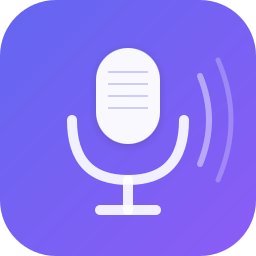
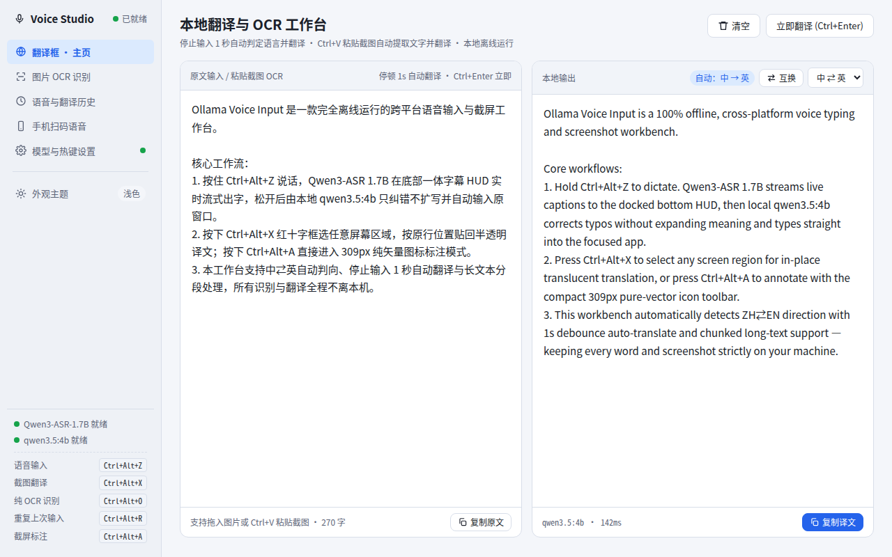
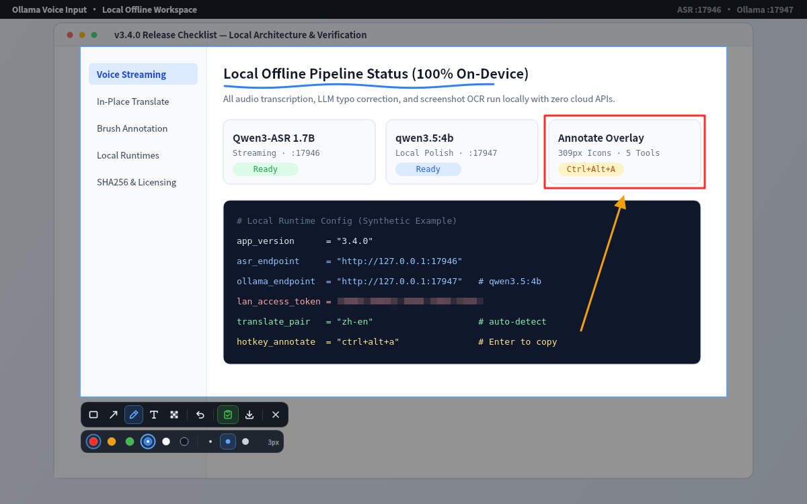

<div align="center">



# Ollama Voice Input

**100% Offline Cross-Platform Voice Typing, In-Place Screenshot Translation & Brush Annotation Workbench**

Hold hotkey to speak → `Qwen3-ASR 1.7B` streaming recognition → local `qwen3.5:4b` typo-only polish → auto-type into any focused app

[简体中文](README.md) · **English** &nbsp;|&nbsp; [🌐 Product Website](https://jackche8.github.io/voice-input/?lang=en) &nbsp;|&nbsp; [⬇️ Download v3.4.4](https://github.com/jackche8/voice-input/releases) &nbsp;|&nbsp; [📄 Commercial License](COMMERCIAL.md)

<br />

[](https://github.com/jackche8/voice-input/releases/tag/v3.4.4)
[](https://jackche8.github.io/voice-input/?lang=en)
[](https://python.org)
[](https://ollama.com)
[](https://github.com/QwenLM/Qwen3-ASR)
[](https://github.com/jackche8/voice-input/releases)
[](LICENSE)

</div>

---

## 🖼️ Real App Screenshots

### Voice Studio Bidirectional Translate & OCR Workbench (Auto-Adapts to Light / Dark Theme)

<picture>
  <source media="(prefers-color-scheme: dark)" srcset="docs/site/assets/workbench-dark.png" />
  <source media="(prefers-color-scheme: light)" srcset="docs/site/assets/workbench-light.png" />
  
</picture>

### Screenshot Brush Annotation (`Ctrl+Alt+A` · 309px Pure-Vector Icon Bar + 34px Pure-Dot Style Bar)



---

## ✨ Five Core Capabilities

- 🗣️ **Global Streaming Voice Typing (`Ctrl+Alt+Z`)** — Hold the hotkey in any application to dictate. A docked bottom subtitle HUD streams stable text and live trailing hypotheses via `Qwen3-ASR 1.7B`; on release, local `qwen3.5:4b` corrects typos without expanding meaning and types straight into the active window, with custom hotwords and rapid-fire queuing.
- 📸 **In-Place Screenshot Translation (`Ctrl+Alt+X`)** — Drag a full-screen red crosshair over any region to detect line layout, translate the passage locally, and overlay translucent background-matched patches right back in place, with a mini bar to copy translation or source text (Simplified Chinese, Traditional Chinese, and English).
- 🖍️ **Screenshot Brush Annotation (`Ctrl+Alt+A`)** — Annotate frozen screenshots with **5 tools (Rectangle, Arrow, Freehand Brush, Text, Mosaic)**, **6 colors**, and **3 stroke/block sizes**. Features a **309px pure-vector icon primary toolbar** and a **34px pure-dot secondary style bar** with zero-jitter anchoring; press `Enter` to copy full-resolution PNG to the clipboard and close.
- 🔎 **Pure In-Place OCR (`Ctrl+Alt+O`) & Repeat Input (`Ctrl+Alt+R`)** — `Ctrl+Alt+O` reuses the red crosshair selector and skips the LLM for instant in-place text extraction; `Ctrl+Alt+R` immediately re-types the last recognized utterance into the focused window.
- 🖥️ **Bidirectional Auto-Translate Workbench & LAN Mobile Voice** — Built-in ZH⇄EN auto-direction detection with **1s debounce auto-translate**, manual `⇄` direction lock, and chunked long-text translation; scan a QR code on your LAN phone for local HTTPS dictation; one app supervises Ollama, ASR, and the local server with one-click setup inside Settings.

---

## ⌨️ Default Hotkeys

| Hotkey | Feature | Description |
|:---:|:---|:---|
| `Ctrl+Alt+Z` | **Global Streaming Voice Input** | Hold to speak with live bottom HUD captions; release to polish & type |
| `Ctrl+Alt+X` | **In-Place Screenshot Translation** | Full-screen red crosshair capture with line-aligned translucent translation overlay |
| `Ctrl+Alt+A` | **Screenshot Brush Annotation** | 5 tools / 6 colors / 3 sizes + 309px icon double bar; `Enter` copies PNG & closes |
| `Ctrl+Alt+O` | **Pure In-Place OCR** | Skips LLM to extract screen text in place with one-click copy |
| `Ctrl+Alt+R` | **Repeat Last Input** | Re-types the last recognized text into the currently focused window |
| `Esc` | **Dismiss Selection / Overlay** | Cancels capture or closes overlay (cancels active text edit first while annotating) |

All hotkeys can be customized in **Models & Hotkeys** inside the main window (stored in `config.json`: `hotkey_voice` / `hotkey_screenshot` / `hotkey_annotate` / `hotkey_ocr` / `hotkey_repeat`) and take effect after restart.

---

## ⬇️ Free Installer Downloads (Recommended)

Official packages are built automatically via GitHub Actions and published on [GitHub Releases](https://github.com/jackche8/voice-input/releases) (see [Packaging & Release Guide](packaging/README.md)):

| Platform | Package (v3.4.4 Direct Link) | Install / Status Notes |
|:---|:---|:---|
| **Linux** (Ubuntu 24.04 amd64, Python 3.12) | [`ollama-voice-input_3.4.4_amd64.deb`](https://github.com/jackche8/voice-input/releases/download/v3.4.4/ollama-voice-input_3.4.4_amd64.deb) | `sudo apt install ./ollama-voice-input_3.4.4_amd64.deb` (isolated venv, ships `uaccess` udev rules without manual `input` group; locally verified) |
| **Windows** (x64) | [`Ollama-Voice-Input-3.4.4-windows-x64-setup.exe`](https://github.com/jackche8/voice-input/releases/download/v3.4.4/Ollama-Voice-Input-3.4.4-windows-x64-setup.exe) | Per-user Inno Setup installer; **unsigned and not yet verified on real Windows hardware** |
| **macOS** (Apple Silicon arm64) | [`Ollama-Voice-Input-3.4.4-macos-arm64.dmg`](https://github.com/jackche8/voice-input/releases/download/v3.4.4/Ollama-Voice-Input-3.4.4-macos-arm64.dmg) | Drag to `Applications`; **unnotarized and not yet verified on real macOS hardware** |
| **Checksums** | [`SHA256SUMS.txt`](https://github.com/jackche8/voice-input/releases/download/v3.4.4/SHA256SUMS.txt) | Verify downloads with `sha256sum -c SHA256SUMS.txt` |

<details>
<summary>⚠️ First-Open Guidance for Unsigned Installers (Windows SmartScreen / macOS Gatekeeper)</summary>

Open-source releases are not commercially code-signed or Apple-notarized yet. Always verify installers against `SHA256SUMS.txt` first:

- **Windows SmartScreen**: If Windows Defender shows *"Windows protected your PC"*, click **More info → Run anyway**. The embedded WebView2 host trusts only the app's own local certificate on `127.0.0.1` (no global SSL bypass).
- **macOS Gatekeeper & Permissions**:
  1. Drag `Ollama Voice Input.app` into `Applications`.
  2. Clear the quarantine attribute in Terminal:
     ```bash
     xattr -cr "/Applications/Ollama Voice Input.app"
     ```
     or Control-click the app → **Open** (or **System Settings → Privacy & Security → Open Anyway**).
  3. Grant **Microphone**, **Accessibility**, and **Screen Recording** permissions on first launch.

</details>

### First Run: One-Click Local Runtime & Model Setup

Open **Models & Hotkeys** in the main window and click **One-Click Setup** to run all 5 steps automatically (resumable on failure; everything installs inside the user data directory with no admin privileges and no changes to system Python):

1. Download and verify official Ollama `0.40.16` release archive
2. Wait for the bundled Ollama server to start (dedicated port `17947`, never conflicts with system Ollama on `11434`)
3. Pull `qwen3.5:4b` for local typo correction and translation
4. Install an isolated Python ASR runtime (auto-selects CUDA / Apple MPS / CPU; CUDA build ~7 GB)
5. Download `Qwen3-ASR-1.7B` weights

**Launch at Login** is enabled by default in Settings (`daemon.py --background`): `~/.config/autostart/ollama-voice-input.desktop` on Linux, `HKCU\Software\Microsoft\Windows\CurrentVersion\Run` on Windows, and `~/Library/LaunchAgents` on macOS.

---

## 🛠️ Run from Source (Developers)

```bash
git clone https://github.com/jackche8/voice-input.git
cd voice-input
python3 -m venv --system-site-packages .venv
.venv/bin/pip install -r requirements.txt

.venv/bin/python daemon.py              # Launch and open the main window
.venv/bin/python daemon.py --background # Tray-only background mode
```

<details>
<summary>🐧 Linux System Dependencies & Hotkey Permissions (Aligned with .deb Control)</summary>

On Debian / Ubuntu, install the system dependencies matching [`packaging/linux/control.in`](packaging/linux/control.in):

```bash
sudo apt install -y \
  python3-venv python3-gi python3-dbus gir1.2-webkit2-4.1 gir1.2-gtk-3.0 \
  libxcb-cursor0 libxkbcommon-x11-0 \
  tesseract-ocr tesseract-ocr-chi-sim tesseract-ocr-chi-tra tesseract-ocr-eng \
  xclip xdotool libportaudio2 zstd
```

- **Wayland desktops**: also install `wl-clipboard` and `wtype`.
- **Global hotkeys (`evdev`) & keystroke injection (`uinput`)**:
  - Installing the official `.deb` package **automatically installs** `/usr/lib/udev/rules.d/70-ollama-voice-input.rules`, granting the active local desktop session access via `systemd-logind` `uaccess` (**no manual `input` group membership required**).
  - When running from source, either install the `uaccess` rule from [`packaging/linux/70-ollama-voice-input.rules`](packaging/linux/70-ollama-voice-input.rules), or add your user to the `input` group with udev rule `KERNEL=="uinput", GROUP="input", MODE="0660"` and re-login.
- **Windows / macOS** source runs use `pywebview` (`pip install pywebview`); grant Microphone, Accessibility, and Screen Recording permissions on macOS. Windows / macOS builds have not yet undergone real hardware QA.

</details>

---

## 📚 Advanced Reference (Tray, Ports, Data Paths & Architecture)

<details>
<summary>🧩 Process Supervision, Tray Menu & Port Overrides (OVI_PORT_*)</summary>

The app supervises 3 local components with exponential backoff restarts (2/4/8/16s, stops after 5 consecutive failures with a notification). Launching a second instance focuses the existing window instead of spawning duplicates:

| Component | Default Address | Override Env Var | Role |
|:---|:---|:---|:---|
| Local Server | `0.0.0.0:17945` (HTTPS) | `OVI_PORT_SERVER` | Main workbench UI, API, and LAN mobile voice page |
| ASR Sidecar | `127.0.0.1:17946` | `OVI_PORT_ASR` | Qwen3-ASR 1.7B streaming speech recognition |
| Bundled Ollama | `127.0.0.1:17947` | `OVI_PORT_OLLAMA` | `qwen3.5:4b` polishing & translation (leaves `11434` untouched) |

- Valid port range is `1–65535` (invalid values fail fast on startup). Overrides propagate automatically to all derived URLs, health probes, and child processes; port conflicts report the occupying PID and process name instead of killing external processes.
- **System Tray Menu**: Open Main Window, In-Place Screenshot Translation, Pure OCR, **Screenshot Annotation** (*截屏标注*), Show Status & Subtitle HUD, Models & Hotkeys, Retry Local Server (shown when server stopped), Quit.

</details>

<details>
<summary>📂 Data Directories & Local HTTPS Certificates</summary>

The program directory is strictly read-only; all user config, history, logs, runtimes, and models live in standard user paths:

| OS | Config Root (config, token, certs) | Data Root (history, jobs, logs, runtimes, models) |
|:---|:---|:---|
| Linux | `$XDG_CONFIG_HOME/ollama-voice-input` (default `~/.config/ollama-voice-input`) | `$XDG_DATA_HOME/ollama-voice-input` (default `~/.local/share/ollama-voice-input`) |
| Windows | `%APPDATA%\Ollama Voice Input` | `%LOCALAPPDATA%\Ollama Voice Input` |
| macOS | `~/Library/Application Support/Ollama Voice Input` | Same as left |

- Config root: `config.json`, `web_input_token`, `certs/` (local Root CA & server cert; auto-verified on startup and renewed when LAN IP changes).
- Data root: `history.jsonl`, `jobs.json`, `logs/`, `runtimes/`, `models/`.
- Manual cert renewal: `.venv/bin/python -m _platform.certs --cert-dir ~/.config/ollama-voice-input/certs`

</details>

<details>
<summary>📁 Project Structure (ui → biz → logic) & Web / OpenAPI Entrypoints</summary>

```text
ollama-voice-input/
├── daemon.py                # App entrypoint: tray, main window, supervision, hotkeys & delivery wiring
├── app.py                   # Local HTTPS server factory (uvicorn)
├── _version.py              # Single source of truth for version (app, installers, CI & website)
├── _paths.py / _ports.py    # Single source of truth for paths and ports
├── _contracts.py            # Single source of truth for v1 schemas (OpenAPI generated from code)
├── _supervision/            # Component specs, supervision state machine, process & port inspection
├── _desktop/                # Desktop business orchestration: supervisor runner, single-instance, autostart, voice/capture flows
├── _window/                 # Main window host (Linux WebKit2GTK; Windows/macOS pywebview)
├── _ui_desktop/             # Native pure UI: red crosshair, in-place overlay, 309px icon annotation, HUD, tray
├── _v3/ + _v3_app.py        # Server routes, auth, production wiring, one-click setup tasks
├── _platform/ + _linux/     # Cross-platform adapters and local Root CA cert management
├── runtimes/asr/            # Qwen3-ASR sidecar and hash-locked variant requirements
├── static/v3/               # Voice Studio home (/), built-in setup (/setup), mobile voice (/voice)
├── packaging/               # Linux .deb / Windows .exe / macOS .dmg build scripts and guide
├── docs/site/               # Zero-build bilingual GitHub Pages site & single-source screenshots
└── scripts/gate.py          # 9-layer unified verification gate (--layer all)
```

- Main window / browser URL: `https://127.0.0.1:17945/` (built-in settings `/setup`; LAN phone voice `/voice`)
- OpenAPI contract snapshot: [`static/v3/openapi.json`](static/v3/openapi.json)

</details>

---

## 📄 Open Source & Commercial Dual License

This project is dual-licensed under **`AGPL-3.0-only` + Commercial License**:

| License Path | Cost | Permitted Scope | Full Terms |
|:---|:---:|:---|:---|
| **Open Source (`AGPL-3.0-only`)** | **100% Free** | Personal download & everyday use, academic research & evaluation, **internal deployment inside companies/organizations**, open-source modification & redistribution under `AGPL-3.0-only` | [`LICENSE`](LICENSE) |
| **Commercial License** | License Required | Closed-source repackaging / white-labeling (OEM), embedding core code into closed-source commercial products, operating closed-source commercial SaaS / hosted services | [`COMMERCIAL.md`](COMMERCIAL.md) |

See [`THIRD-PARTY-NOTICES.md`](THIRD-PARTY-NOTICES.md) for third-party open-source dependencies and LGPL dynamic-linking replaceability notes. For commercial licensing inquiries, contact the maintainers via [GitHub Issues](https://github.com/jackche8/voice-input/issues) or [GitHub Discussions](https://github.com/jackche8/voice-input/discussions).
