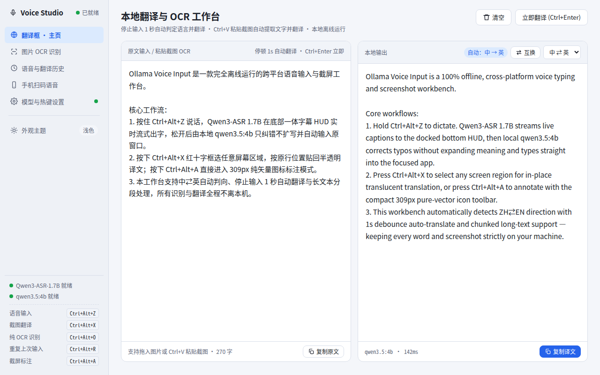
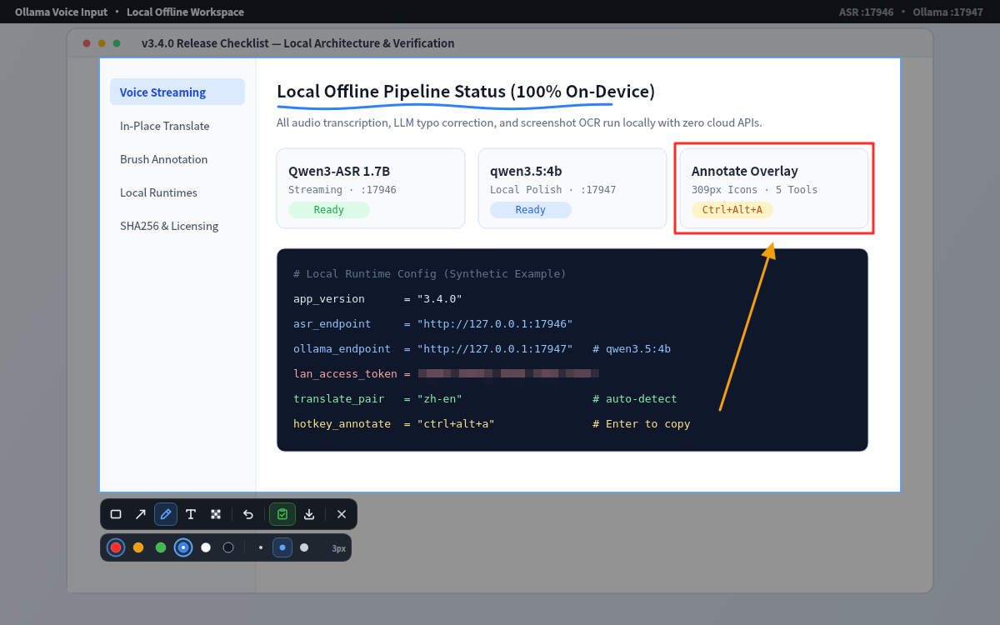

<div align="center">


# Ollama Voice Input

**100% 本地离线的跨平台语音输入、截屏原位翻译与画笔标注工作台**

按住快捷键说话 → `Qwen3-ASR 1.7B` 流式识别 → 本地 `qwen3.5:4b` 只纠错不扩写 → 自动输入到任意应用

**简体中文** · [English](README.en.md) &nbsp;|&nbsp; [🌐 产品主页](https://jackche8.github.io/voice-input/) &nbsp;|&nbsp; [⬇️ 免费下载 v3.4.9](https://github.com/jackche8/voice-input/releases) &nbsp;|&nbsp; [📄 商业授权](COMMERCIAL.md)

<br />

[](https://github.com/jackche8/voice-input/releases/tag/v3.4.9)
[](https://jackche8.github.io/voice-input/)
[](https://python.org)
[](https://ollama.com)
[](https://github.com/QwenLM/Qwen3-ASR)
[](https://github.com/jackche8/voice-input/releases)
[](LICENSE)

</div>

---

## 🖼️ 实机界面一览

### Voice Studio 双向翻译与 OCR 工作台（自动适配 GitHub 浅/深主题）

<picture>
  <source media="(prefers-color-scheme: dark)" srcset="docs/site/assets/workbench-dark.png" />
  <source media="(prefers-color-scheme: light)" srcset="docs/site/assets/workbench-light.png" />
  
</picture>

### 截屏画笔标注（`Ctrl+Alt+A` · 309px 纯矢量图标主条 + 34px 纯圆点二级条）



---

## ✨ 五大核心特性

- 🗣️ **全局流式语音输入（`Ctrl+Alt+Z`）** — 任意应用中按住说话，屏幕底部居中一体字幕 HUD 实时呈现稳定字与流式尾字；松开后交由本地 `qwen3.5:4b` 只纠错不扩写并自动输入原焦点窗口，支持自定义热词与连按排队。
- 📸 **截屏原位翻译（`Ctrl+Alt+X`）** — 全屏红色十字框选任意区域，按行识别原文位置与格式，本地整段翻译后以采样底色半透明贴片精准排回原位；框下迷你菜单一键复制译文或原文，支持简体、繁体与英文。
- 🖍️ **截屏画笔标注（`Ctrl+Alt+A`）** — 框选冻结画面后直接进行**矩形、箭头、自由画笔、文字、马赛克** 5 种标注，提供 **6 色色板 × 3 档粗细**；采用 **309px 纯矢量图标主条** + **34px 纯圆点二级样式条**零抖动定位，按 `Enter` 自动复制原分辨率 PNG 到剪贴板并关闭。
- 🔎 **纯 OCR 原位识别（`Ctrl+Alt+O`）& 重复输入（`Ctrl+Alt+R`）** — `Ctrl+Alt+O` 复用红十字框选与原位浮窗，跳过 LLM 秒级提取屏幕文字；`Ctrl+Alt+R` 将上一次识别结果立即重发到当前焦点窗口。
- 🖥️ **双向自动翻译工作台 & 局域网手机语音** — 内置中⇄英自动判向、停止输入 **1 秒防抖自动翻译**、`⇄` 手动锁定方向与长文本分段翻译；同局域网手机扫码打开本地 HTTPS 录音页录入电脑；一个应用统一看护 Ollama、ASR 与本地服务端并在设置页一键装齐全部模型。

---

## ⌨️ 默认快捷键

| 快捷键 | 功能 | 说明 |
|:---:|:---|:---|
| `Ctrl+Alt+Z` | **全局流式语音输入** | 按住说话，底部一体 HUD 实时流式出字，松开纠错并自动输入 |
| `Ctrl+Alt+X` | **截屏原位翻译** | 全屏红十字框选，译文以半透明贴片按原行位置排回 |
| `Ctrl+Alt+A` | **截屏画笔标注** | 5 工具 / 6 色 / 3 档 + 309px 图标双条，`Enter` 复制 PNG 并关闭 |
| `Ctrl+Alt+O` | **纯 OCR 识别** | 跳过 LLM，复用红十字框选与原位浮窗快速提取屏幕文字 |
| `Ctrl+Alt+R` | **重复输入** | 将上一次识别文本重发到当前焦点窗口 |
| `Esc` | **关闭选区 / 浮窗** | 取消框选或关闭原位浮窗（标注文字输入中先取消当前编辑） |

全部快捷键可在主窗口「模型与热键设置」自定义（写入配置根 `config.json`：`hotkey_voice` / `hotkey_screenshot` / `hotkey_annotate` / `hotkey_ocr` / `hotkey_repeat`），修改后重启应用生效。

---

## ⬇️ 安装包免费下载（推荐）

官方安装包由 GitHub Actions 自动构建并发布于 [GitHub Releases](https://github.com/jackche8/voice-input/releases)（[打包与发布详情](packaging/README.md)）：

| 平台 | 安装包（v3.4.9 直链） | 安装方式 / 状态说明 |
|:---|:---|:---|
| **Linux**（Ubuntu 24.04 amd64，Python 3.12） | [`ollama-voice-input_3.4.9_amd64.deb`](https://github.com/jackche8/voice-input/releases/download/v3.4.9/ollama-voice-input_3.4.9_amd64.deb) | `sudo apt install ./ollama-voice-input_3.4.9_amd64.deb`（独立 venv，内置 `uaccess` 规则免手动加 `input` 组，本地已验证） |
| **Windows**（x64） | [`Ollama-Voice-Input-3.4.9-windows-x64-setup.exe`](https://github.com/jackche8/voice-input/releases/download/v3.4.9/Ollama-Voice-Input-3.4.9-windows-x64-setup.exe) | Per-user Inno Setup 安装器，**未签名且未经 Windows 真机验收** |
| **macOS**（Apple Silicon arm64） | [`Ollama-Voice-Input-3.4.9-macos-arm64.dmg`](https://github.com/jackche8/voice-input/releases/download/v3.4.9/Ollama-Voice-Input-3.4.9-macos-arm64.dmg) | 拖入 `Applications`，**未公证且未经 macOS 真机验收** |
| **完整性校验** | [`SHA256SUMS.txt`](https://github.com/jackche8/voice-input/releases/download/v3.4.9/SHA256SUMS.txt) | 下载后执行 `sha256sum -c SHA256SUMS.txt` 核对哈希 |

<details>
<summary>⚠️ Windows SmartScreen / macOS Gatekeeper 未签名安装包首次打开指引</summary>

开源构建暂未购买商业代码签名证书与 Apple Developer ID 公证，请先使用 `SHA256SUMS.txt` 校验安装包完整性：

- **Windows SmartScreen**：如提示「Windows 已保护你的电脑」，点击 **「更多信息」→「仍要运行」**（*More info → Run anyway*）。内嵌 WebView2 仅放行本机 `127.0.0.1` 自签证书，无全局 SSL 忽略。
- **macOS Gatekeeper 与系统权限**：
  1. 将 `Ollama Voice Input.app` 拖入 `Applications`（应用程序）。
  2. 在终端执行解除隔离属性：
     ```bash
     xattr -cr "/Applications/Ollama Voice Input.app"
     ```
     或右键点击应用选择 **「打开」**（或在 **系统设置 → 隐私与安全性** 点击 **「仍要打开」**）。
  3. 首次启动请授予 **麦克风**、**辅助功能** 与 **屏幕录制** 权限。

</details>

### 首次运行：一键装齐本地运行环境与模型

启动后打开主窗口 **「模型与热键设置」**，点击 **「一键装齐」** 依次自动完成 5 步（失败停在当前步骤可重试，全部装在用户数据目录，无需管理员权限、不污染系统 Python）：

1. 下载并校验官方 Ollama `0.40.16` 发行包
2. 等待本应用自带 Ollama 启动（独立端口 `17947`，不与用户自装 Ollama 的 `11434` 冲突）
3. 拉取本地纠错与翻译模型 `qwen3.5:4b`
4. 安装独立 Python 语音识别运行环境（按硬件自动匹配 CUDA / Apple MPS / CPU，CUDA 版约 7 GB）
5. 下载 `Qwen3-ASR-1.7B` 识别权重

设置页自带 **「开机自启」** 开关（默认开启，后台托盘启动 `daemon.py --background`）：Linux 写入 `~/.config/autostart/ollama-voice-input.desktop`、Windows 写入 `HKCU\Software\Microsoft\Windows\CurrentVersion\Run`、macOS 写入 `~/Library/LaunchAgents`。

---

## 🛠️ 从源码安装与运行（开发者）

```bash
git clone https://github.com/jackche8/voice-input.git
cd voice-input
python3 -m venv --system-site-packages .venv
.venv/bin/pip install -r requirements.txt

.venv/bin/python daemon.py              # 启动并打开主窗口
.venv/bin/python daemon.py --background # 仅托盘后台运行
```

<details>
<summary>🐧 Linux 系统依赖与快捷键权限说明（与 .deb 依赖保持一致）</summary>

Debian / Ubuntu 源码运行需安装以下系统包（对齐 [`packaging/linux/control.in`](packaging/linux/control.in)）：

```bash
sudo apt install -y \
  python3-venv python3-gi python3-dbus gir1.2-webkit2-4.1 gir1.2-gtk-3.0 \
  libxcb-cursor0 libxkbcommon-x11-0 \
  tesseract-ocr tesseract-ocr-chi-sim tesseract-ocr-chi-tra tesseract-ocr-eng \
  xclip xdotool libportaudio2 zstd
```

- **Wayland 桌面**另建议安装：`wl-clipboard`、`wtype`。
- **全局快捷键（evdev）与键盘输入（uinput）权限**：
  - 安装官方 `.deb` 包会**自动部署** `/usr/lib/udev/rules.d/70-ollama-voice-input.rules`（通过 `systemd-logind` `uaccess` 授予当前登录桌面会话权限，**无需**手动将用户加入 `input` 组）。
  - 若从源码直接运行，可参考 [`packaging/linux/70-ollama-voice-input.rules`](packaging/linux/70-ollama-voice-input.rules) 配置 `uaccess` 规则，或将当前用户加入 `input` 组并配置 `/dev/uinput` 规则 `KERNEL=="uinput", GROUP="input", MODE="0660"` 后重新登录。
- **Windows / macOS** 源码运行主窗口依赖 `pywebview`（`pip install pywebview`）；macOS 首次使用需授予「麦克风」「辅助功能」与「屏幕录制」权限。Windows / macOS 尚未经真机验收。

</details>

---

## 📚 进阶参考（托盘、端口、数据目录与项目结构）

<details>
<summary>🧩 组件看护、托盘菜单与环境变量端口覆盖（OVI_PORT_*）</summary>

应用启动后依次拉起并看护 3 个组件，异常退出自动退避重启（2/4/8/16 秒，连续失败 5 次停止并提示）；再次运行会唤起已有主窗口而非双开：

| 组件 | 默认地址 | 覆盖环境变量 | 作用 |
|:---|:---|:---|:---|
| 本地服务端 | `0.0.0.0:17945`（HTTPS） | `OVI_PORT_SERVER` | 主窗口页面、API 与局域网手机扫码语音页 |
| 语音识别服务 | `127.0.0.1:17946` | `OVI_PORT_ASR` | Qwen3-ASR 1.7B 流式识别 sidecar |
| 应用自带 Ollama | `127.0.0.1:17947` | `OVI_PORT_OLLAMA` | `qwen3.5:4b` 纠错与翻译（不占 `11434`） |

- 环境变量取值 `1–65535`（非法值启动即报错），设置后自动同步全部派生地址与探针并透传给子进程；端口被占用时不抢占，提示占用者 PID 与进程名。
- **托盘菜单**：打开主界面、截屏原位翻译、纯 OCR 识别、**截屏标注**、显示状态与字幕提示、模型与热键设置、重试启动本地服务（服务停止时出现）、退出。

</details>

<details>
<summary>📂 数据目录与本地 HTTPS 证书</summary>

程序目录只读，所有配置、历史与模型保存在用户目录：

| 系统 | 配置根（配置、令牌、证书） | 数据根（历史、任务、日志、运行环境、模型） |
|:---|:---|:---|
| Linux | `$XDG_CONFIG_HOME/ollama-voice-input`（缺省 `~/.config/ollama-voice-input`） | `$XDG_DATA_HOME/ollama-voice-input`（缺省 `~/.local/share/ollama-voice-input`） |
| Windows | `%APPDATA%\Ollama Voice Input` | `%LOCALAPPDATA%\Ollama Voice Input` |
| macOS | `~/Library/Application Support/Ollama Voice Input` | 同左 |

- 配置根：`config.json`、`web_input_token`、`certs/`（本地 Root CA 与服务端证书，启动自动检查并在局域网 IP 变化时自动续签）。
- 数据根：`history.jsonl`、`jobs.json`、`logs/`、`runtimes/`、`models/`。
- 手动重签证书：`.venv/bin/python -m _platform.certs --cert-dir ~/.config/ollama-voice-input/certs`

</details>

<details>
<summary>📁 项目结构（ui → biz → logic）与 Web / API 入口</summary>

```text
ollama-voice-input/
├── daemon.py                # 应用入口：托盘、主窗口、组件看护、快捷键与投递装配
├── app.py                   # 本地服务端工厂（uvicorn）
├── _version.py              # 版本号唯一来源（应用、三端打包、CI 与主页共用）
├── _paths.py / _ports.py    # 路径表与端口表（唯一来源）
├── _contracts.py            # v1 契约唯一来源（OpenAPI 由代码导出）
├── _supervision/            # 组件规格、看护状态机、进程记录与端口占用查询
├── _desktop/                # 桌面业务编排：看护运行器、主窗口启动器、单实例、开机自启、语音/截屏流
├── _window/                 # 主窗口进程（Linux WebKit2GTK；Windows/macOS pywebview）
├── _ui_desktop/             # 原生纯 UI：红十字框选、原位译文浮窗、309px 图标截屏标注、底栏字幕、托盘
├── _v3/ + _v3_app.py        # 服务端路由、鉴权、生产装配、一键装齐任务
├── _platform/ + _linux/     # 三端平台适配与本地 Root CA 证书管理
├── runtimes/asr/            # Qwen3-ASR sidecar 与锁定依赖
├── static/v3/               # Voice Studio 主页（/）、内置设置（/setup）、手机录音页（/voice）
├── packaging/               # Linux .deb / Windows .exe / macOS .dmg 打包脚本与说明
├── docs/site/               # GitHub Pages 零构建双语产品主页与单源实机截图
└── scripts/gate.py          # 9 层统一测试门禁（--layer all）
```

- 主窗口 / 浏览器入口：`https://127.0.0.1:17945/`（内置设置直达 `/setup`；局域网手机扫码语音页 `/voice`）
- OpenAPI 契约快照：[`static/v3/openapi.json`](static/v3/openapi.json)

</details>

---

## 📄 开源与商业双许可

本项目采用 **`AGPL-3.0-only` + 商业授权** 双许可模式，边界清晰：

| 许可路径 | 费用 | 适用场景 | 完整条款 |
|:---|:---:|:---|:---|
| **开源许可（`AGPL-3.0-only`）** | **完全免费** | 个人下载与日常使用、学术研究与教学评估、**企业/组织内部部署自用**、遵守 `AGPL-3.0-only` 全部条款的开源修改与分发 | [`LICENSE`](LICENSE) |
| **商业授权（Commercial License）** | 需商业许可 | 闭源二次封装 / 贴牌分发（OEM / White-label）、将核心代码集成至闭源商业产品分发、基于本软件提供闭源商业 SaaS / 托管服务 | [`COMMERCIAL.md`](COMMERCIAL.md) |

第三方开源组件及 LGPL 动态链接可替换说明详见 [`THIRD-PARTY-NOTICES.md`](THIRD-PARTY-NOTICES.md)。商业授权咨询请通过 [GitHub Issues](https://github.com/jackche8/voice-input/issues) 或 [GitHub Discussions](https://github.com/jackche8/voice-input/discussions) 联系维护者。
