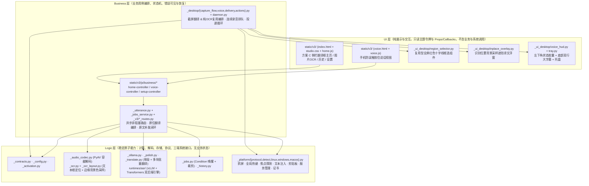

# v3.2 跨平台（Linux / Windows / macOS）生产化重构与全链路根治方案

> **状态**：待用户最终确认（Confirmed UI Standard: [option-c-studio.html](./docs/design/v3.2/option-c-studio.html)）  
> **日期**：2026-11-17  
> **架构准则**：严格 `ui → biz → logic` 三层单向依赖 · 单一事实源 · 先减法再复用后新建

---

## 一、 最终目标（一句话定位）

消除当前阻碍投产的全部 28 项链路缺陷与 Linux 独占耦合，交付一套支持 **Linux / Windows / macOS** 三端架构、以**侧栏翻译框为主页（`/`）**、复用**全屏红色十字线定位框选器**实现**识别位置背景遮挡原位翻译**与**纯 OCR 自动复制**、并具备稳定离线**流式语音输入（本机 + 手机局域网）**的生产可用系统。

---

## 二、 变更前后行为对比

| 维度 | 当前现状（Before） | 目标状态（After） |
| :--- | :--- | :--- |
| **主页入口 (`/`)** | 访问 `/` 返回 `404`，只有 `/setup` 设置页，无手动文本翻译与图片粘贴 OCR 工作台 | 访问 `/`（及桌面/托盘主入口）直达 **方案 C 侧栏翻译与 OCR 工作台**：支持手动粘贴文本翻译、`Ctrl+V` 粘贴截图提取 OCR/翻译、明暗主题切换；历史/手机/设置收于左侧栏 |
| **框选定位组件** | 仅 Linux GTK 实现（[_linux/selection.py](./_linux/selection.py)），无十字定位线，且无法在 Win/Mac 运行 | 独立跨平台 UI 原子模块 `_ui_desktop/region_selector.py`（`PySide6-Essentials`）：**贯穿全屏红色十字准星 (`#ff2d2d`) + 实时坐标/尺寸读数**，由「截屏原位翻译 (`Ctrl+Alt+X`)」与「纯 OCR (`Ctrl+Alt+O`)」100% 复用 |
| **截屏翻译浮窗** | 每次截图冷启动新 WebKit2GTK 子进程，白底黑框、`resizable=False` 尺寸失效，整块覆盖无局部背景还原，“已复制”状态不更新 | 跨平台毫秒级 `InplaceTranslateOverlay`：保留截图排版与代码块，按 Tesseract 检测出的**每个文字块坐标采样原背景色 100% 不透明遮盖原文**并原位渲染译文，附带 `[按住看原图] [复制译文] [复制原文] [Esc]` |
| **纯 OCR 识别** | 无独立热键，必须在设置页改全局下拉框为“仅识别”再改回 | 新增 `Ctrl+Alt+O` 全局热键（复用红十字框选器）：框选松手跳过 LLM 秒级提取文字（`chi_sim+eng`），**自动写入系统剪贴板**并在左下角胶囊提示字数；主页亦支持粘贴图片纯 OCR |
| **语音视觉反馈** | `StatusWindow` 固定 `360×96` 堆叠 8 条胶囊，最新字幕被顶出上边界不可见；SSE 断线直接调 `close()` 永久失联 | 方案 C 双态反馈：左下角轻量真透明状态胶囊 + **录音时屏幕底部中央双行大字幕条**（完成后 1.5s 淡出）；状态流断线指数退避自动重连 |
| **桌面文字注入与剪贴板** | Linux Wayland 下 IBus 探针误查 `--session` 永久失效；回退硬发 `Ctrl+Shift+V` 导致主流应用无法粘贴；图片剪贴板被清空；焦点恒为 `0` | 修复 IBus 私有总线探测恢复无损直提交；三端平台适配（Linux `Ctrl+V`/终端 `Ctrl+Shift+V` + 拦截自窗口注入 + MIME 剪贴板保护；Win `SendInput`/剪贴板；Mac `CGEvent`/`pbcopy`+`Cmd+V`） |
| **手机网页语音 (`/voice`)** | 上传压缩 `webm/mp4` 未解码被当成裸 16kHz PCM 白噪音；每 250ms 销毁重建按钮丢触控；`?token=` 写入 `journalctl` 明文日志；10 年证书被 iOS 拒认 | 服务端 `_audio_codec.py`（复用已装 `PyAV`）统一解码重采样为 `16kHz mono s16le PCM`；固定按钮 DOM + `touch-action: none`；URL `#token=` 片段 + `sessionStorage`；本地根 CA + `<=397` 天网卡 IP 自动同步证书 |
| **GPU 显存与本地模型** | ASR `util=0.8` 独占 `11.15 GiB`（16GB 卡仅剩 `3.6 GiB`），与 `qwen3.5:4b` 互斥；私有 Ollama 抢占系统 `:11434`；口述提问会触发模型作答扩写 | ASR `util=0.45`、`max_model_len=4096`（预计占 ~7.2 GiB），私有 Ollama 独立绑定 `127.0.0.1:17947`（`num_ctx=2048`），16GB 卡稳态双模型全 GPU 共存；`<asr_transcript>` 边界隔离 + `temperature=0` + 长度突变拦截 |
| **并发、队列与跨平台引擎** | 主服务与 Sidecar 多个 `async def` 同步阻塞事件循环引发 120s 自死锁；`jobs.json` 每 0.2s 全表锁盘解析；ASR 仅支持 Linux vLLM | 全部阻塞调用 `asyncio.to_thread` 卸载；`EngineScheduler` 原子移交槽位 + 15s `sweep` 回收；`jobs` 改为 `Condition` 事件唤醒 + 历史裁剪；ASR 支持 **Linux `vLLM` + Win/Mac `Transformers (CUDA/MPS/CPU)`** 双后端 |
| **废弃冗余文件** | 残留损坏的 `screenshot_ui.py`、`lite/`、`_webkit_host.py`、旧 `override.conf` 与幽灵热键 `ai.opencode.desktop` | 同次彻底清理废弃双轨文件与旧配置，保持单一代码事实源 |

---

## 三、 收益与代价评估

* **核心收益**：
  1. **显存与稳定性（实测依据）**：本机 RTX 5070 Ti 总显存 `16,303 MiB`，实测 `Qwen3-ASR-1.7B` 权重加载仅需 `3.87 GiB`；将 `gpu_memory_utilization` 从 `0.80`（实测占 `11,154 MiB`）收敛至 `0.45`（上限约 `7,336 MiB`，仍留 >3 GiB KV 缓存余量），可释放约 **`3.8 GiB` 显存**，使 `qwen3.5:4b`（预计占 `3.5~4.0 GiB`）与桌面合成器稳定全 GPU 同驻。
  2. **浮窗响应速度与内存（预期依据：消除浏览器子进程冷启动）**：以原生 `PySide6-Essentials` 替代每次截图新建 `WebKit2.WebContext`，预计浮窗首帧弹出从 **300~800ms 降至 <15ms**，省去每次截图约 **100MB+** 临时 WebKit 进程开销。
  3. **空闲 CPU 与磁盘 I/O（实测计算依据）**：消除 `jobs/claim` 每 0.2s 双次全表解析，从 **864,000 次/天** 磁盘锁与 Pydantic 全量解析降至 **0 次空闲轮询**（仅入队时内存信号唤醒）。
* **引入代价**：
  1. Python 环境新增 `PySide6-Essentials`（约 60MB 稳定 ABI 轮子，已实测兼容本机 Python 3.14.4）与轻量跨平台抓屏库 `mss`（本地已缓存）。
  2. Windows 与 macOS 适配层受限于当前物理环境为 Linux，本轮交付完整实现与自动化模拟契约测试，物理窗口交互需后续在对应系统真机复核。

---

## 四、 三层模块化架构与逻辑流 (`ui → biz → logic`)

### 核心链路前后差异

1. **截屏原位翻译与纯 OCR 链路（共享红色十字线框选器）**：
   * **现状**：`热键 → Linux portal/maim → 整区裁切 → 拉起新 WebKit 进程请求 /ocr-translate → 白底卡片整块显示`（无纯 OCR 热键、无十字线、无局部背景遮挡）。
   * **目标**：`Ctrl+Alt+X (翻译) 或 Ctrl+Alt+O (纯OCR) → _platform.capture_fullscreen() → RedCrosshairSelector(全屏红十字定位框选，两功能共用) → 裁切选区 PNG`：
     * 分支 A（`Ctrl+Alt+X`）：`POST /api/v1/ocr-inplace → _ocr_layout(提取各文字块 bbox + 采样局部背景/前景色) → _translate.translate_blocks(批量本地翻译) → InplaceTranslateOverlay(原图打底 + 各文字块原位不透明背景遮挡渲染译文)`。
     * 分支 B（`Ctrl+Alt+O`）：`POST /api/v1/ocr-inplace(target_lang=raw) → 秒级返回纯 OCR 文本 → 自动写入剪贴板 + 左下角胶囊提示“已复制 OCR 文本”`。

2. **主页手动翻译与粘贴图片 OCR 链路**：
   * **现状**：`GET / → 404 Not Found`。
   * **目标**：`GET / → 方案 C 翻译工作台 → 输入/粘贴文本调 POST /api/v1/translate（或 Ctrl+V 粘贴截图调 POST /api/v1/ocr-translate） → 右栏即时渲染译文或纯 OCR 原文`。

3. **语音输入链路（本机 + 手机）**：
   * **现状**：`手机录 webm → 未解码当裸 PCM 送 ASR 变白噪音`；`本机松手 → Wayland 误判 IBus 失效 → 硬发 Ctrl+Shift+V 失败且毁图片剪贴板`。
   * **目标**：
     * 手机：`固定 DOM 按钮录音 → 上传 webm/mp4 → _audio_codec(PyAV 转 16kHz s16le PCM) → ASR → 4B 严控边界只纠错 → Condition 零延迟唤醒投递`。
     * 本机：`按住说话(传入热词 context，连按自动排队不报 409) → 底部居中实时双行大字幕 → 松手 4B 只纠错 → Linux 优先 IBus 私有总线直提交 / Win SendInput / Mac CGEvent（回退智能剪贴板保图片 + 终端识别）`。

---

## 五、 影响范围、验收标准与未知项处理

### 1. 删除清理清单（先做减法，不留双轨）
* 删除已损坏或被统一跨平台壳取代的旧文件：`screenshot_ui.py`、`lite/`、`_webkit_host.py`、`_overlay.py`、`_linux/overlay_windows.py`、`_linux/selection.py`、`_linux/tray.py`、`static/v3/overlay-status.html`、`static/v3/overlay-translate.html`、`static/v3/js/overlay-status.js`、`static/v3/js/overlay-translate.js`、`static/v3/js/business/status-controller.js`、`static/v3/js/business/translate-controller.js`、`static/v3/js/business/claim.js`。
* 清理本机残留冲突：`~/.config/systemd/user/ollama-voice-daemon.service.d/override.conf` 及 GNOME dconf 中幽灵 `ai.opencode.desktop` 重复热键登记。

### 2. 完成定义（Definition of Done）
1. **自动化门禁全绿**：逻辑层、业务层、API 契约（`openapi.json` 同步生成）、跨平台适配层（Linux/Win/Mac 契约单测）与前端 UI（Node 测试套件）全部通过，零吞错。
2. **Linux 真机实测闭环**：
   * `ollama-voice-asr`（`util=0.45`）与 `ollama-voice-ollama`（`127.0.0.1:17947` + `qwen3.5:4b`）同时加载进本机 RTX 5070 Ti 显存，无 OOM、无 CPU 降级；
   * 浏览器打开 `https://127.0.0.1:17945/` 呈现方案 C 翻译框主页，实测文本翻译与图片 OCR 均返回真实结果；
   * `daemon.py` 正常常驻，实测红十字框选器、识别位置背景遮挡翻译浮窗、纯 OCR 自动复制、流式语音大字幕与 IBus/剪贴板注入全部通过；
   * 实测真机证据齐全后，清空 `_activation.py` 中的 `PRODUCTION_UNMET_GATES`，使 `./start.sh` 与桌面图标正式可用。

### 3. 剩余外部未知项处理机制
* **`qwen3.5:4b` 下载时的路由器 Fake-IP（`198.18.75.191`）**：执行阶段先检测本机代理端口或真实 DNS 可达性；若透明代理仍将 `*.r2.cloudflarestorage.com` 解析为 `198.18.x` 且无本地代理端口可用，将立即带精确证据向你汇报，由你在代理规则中放行该域名真实 DNS 后一键完成拉取，绝不用假模型冒充验收。
* **Windows / macOS 真机图形环境**：本机为 Linux，Win32 与 macOS Quartz 适配层通过注入式系统调用契约测试验证，并在交付报告中明确区分“本机真机实测通过（Linux）”与“模拟契约验证通过（Windows / macOS）”。

---

## 六、 模块化执行编排（Executor + Reviewer 成对独立复核）

直接在主工作区 `main` 分支推进（不建分支/worktree），按职责严格切分文件所有权，同一轮内无文件交叉，每条工作线均配备 **1 名执行 Agent + 1 名独立复核 Agent**：

| 阶段 | 工作线 | 独占负责文件范围 | 依赖前提 |
| :--- | :--- | :--- | :--- |
| **第一波（并行：基础契约先行后四线并发）** | **前置 Step 0（主控自建，10min）**：冻结契约与令牌 | `_contracts.py`、`_config.py` | 方案获用户确认 |
| ↳ 并行线 1 | **Line UI-Web（方案 C 网页工作台 + 手机页）** | `static/v3/index.html`、`static/v3/setup.html`、`static/v3/voice.html`、`static/v3/css/*`、`static/v3/js/{home,setup,voice,dom,labels,defaults,hotkey-capture}.js` | Step 0 完成 |
| ↳ 并行线 2 | **Line UI-Desktop（跨平台 Qt 红十字框选 + 原位遮挡浮窗 + 大字幕）** | `_ui_desktop/{__init__,theme,region_selector,inplace_overlay,voice_hud,tray}.py` + `tests/ui_desktop/*` | Step 0 完成 + 安装 `PySide6-Essentials`、`mss` |
| ↳ 并行线 3 | **Line Logic-Core（容器解码 + OCR 布局背景采样 + 4B 护栏 + 双后端 ASR + 事件队列）** | `_audio_codec.py`、`_ocr.py`、`_ocr_layout.py`、`_ollama.py`、`_polish.py`、`_translate.py`、`_jobs.py`、`_jobs_service.py`、`_history.py`、`_session_finals.py`、`_events.py`、`runtimes/asr/*` + 对应 `tests/{logic,sidecar}/*` | Step 0 完成 |
| ↳ 并行线 4 | **Line Logic-Platform（Linux 根治 + Windows + macOS 平台适配 + 短期根 CA 证书）** | `_platform/{__init__,protocol,detect,linux,windows,macos,certs}.py`、`_linux/*`（修复 `ibus`/`paste_backend`/`clipboard`/`hotkey_portal`/`modifiers`/`mic`）+ `tests/platform/*` | Step 0 完成 |
| **第二波（串行组装）** | **Line Biz-Assembly（服务端路由 + 前端控制器 + 桌面守护装配 + 跨平台启动脚本 + 旧文件清理）** | `_utterance.py`、`_asr.py`、`_asr_provider.py`、`_v3/*`、`_v3_app.py`、`static/v3/js/business/*`、`_desktop/*`、`daemon.py`、`systemd/*`、`install.sh`、`start.sh`、`restart.sh`、`scripts/start.{ps1,command}`、`README.md` + 删除废弃旧文件 + 更新 `openapi.json` | 第一波 4 条线全部通过各自独立 Reviewer 复核 |
| **第三波（全量门禁与真机验收）** | **主控终审 + 真机双模型联调 + 关闭生产门闩** | 运行全量测试门禁、启动 4 服务实测显存共存 / 网页翻译 / 红十字框选原位翻译 / 纯 OCR / 语音输入，证据齐备后更新 `_activation.py` | 第二波通过独立 Reviewer 复核 |
