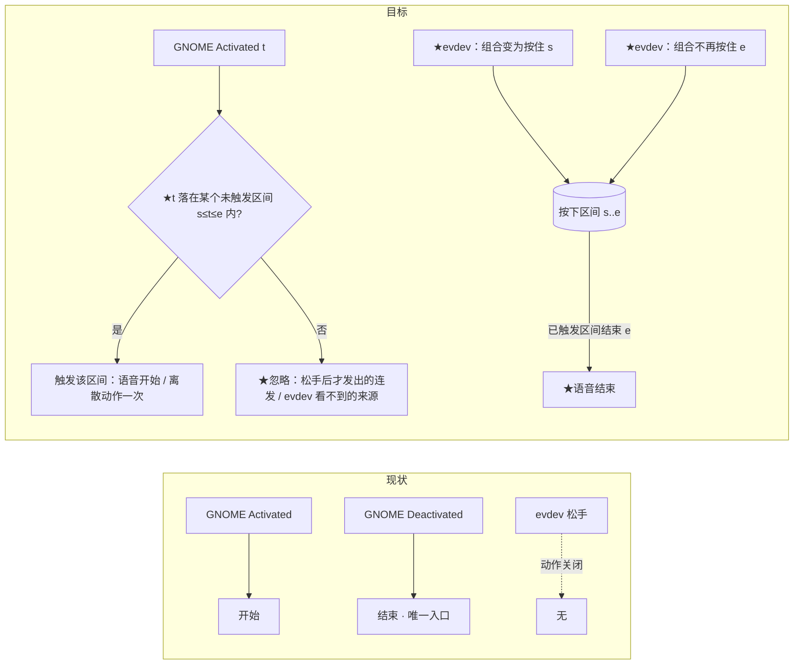

# v3.3 截屏原位识别/翻译 · 语音悬浮窗动效 · 快捷键松手根治

> 状态：用户已批准（2026-11-19）。**阶段一已完成**：最终审查通过、闸门 `--layer all` 全绿（.pp/gate/all/summary.txt 2026-11-19T22:17:52）、真机验收通过（3 次录音松手后 1–2ms 内停止），已提交。阶段二执行中。
> 基线：v3.2 已提交 `a1e2c07`（闸门 `--layer all` 全绿）。
> 记录位置：ppwiki 不可用，按 AGENTS.md（2026-11-17）方案记录在 `docs/plans/`，模板在 `docs/design/v3.3/`。

## 一、目的

截屏识别/翻译的结果按原文位置逐行贴回、保留格式、可对照；语音输入只有一个带动效的悬浮条；按住说话的快捷键无论先松哪个键，录音都立刻停止。

## 二、已锁决策（用户选择，2026-11-19）

| # | 决策 | 取代 |
|---|---|---|
| D1 | 语音悬浮窗 = 模板 `docs/design/v3.3/voice-a.html`「一体底栏」，UI 验收标准 | v3.2 左下角胶囊 + 底部字幕两个窗 |
| D2 | 截屏浮窗 = 模板 `docs/design/v3.3/overlay-a.html`「贴合原图」：采样底色 86% 半透明贴片，UI 验收标准 | v3.2 方案 C「100% 不透明遮挡」 |
| D3 | 点框外空白处只关闭浮窗，这次点击不传给下层程序；Esc 关闭 | v3.2 仅 Esc/任意键/按钮 |
| D4 | 译文对位：整段翻译，按原文字号与行距从该段第一行起排在原段落范围内；放不下先缩字号（下限 9px），仍放不下才向下延伸 | v3.2 按整块高度×0.72 起缩、随意下延 |
| D5 | 纯 OCR（Ctrl+Alt+O）= 原位显示识别结果 + 框下迷你菜单「复制」，不再自动写剪贴板、不再弹字数提示 | v3.2「纯 OCR 自动复制 + 胶囊提示」 |
| D6 | 翻译模式迷你菜单「复制译文 / 复制原文」；失败时显示原因 +「重试」；去掉「按住对比原图」 | v3.2 整条工具栏 |
| D7 | 快捷键松手：组合里任意一个键物理松开即结束（与松手顺序无关） | v3.2 只认 GNOME `Deactivated` |
| D8 | 代码行保持原样，只翻译注释与自然语言；复制格式所见即所得：保留每个可见换行与缩进，段与段之间空一行 | — |

## 三、根因（证据）

### 3.1 先松 Ctrl/Alt 录音不停（已确认）

- 证据：`.pp/tmp/hotkey-release-probe/{keys,portal}.log`（物理按键与门户信号双时间线）。先松 Z：Z UP 29.711s → `Deactivated` 29.716s；先松 Alt/Ctrl：LALT UP 64.359s、LCTRL UP 64.387s、Z UP 64.883s → **无 `Deactivated`**，直到 74.455s 下一次「先松 Z」才发出。按住期间 `Activated` 约 33Hz 连发，修饰键一松连发即停。
- 机制：触发 → 用户先松修饰键 → GNOME 不发 `Deactivated` → 门户后端唯一的停止入口 `_linux/hotkey_portal.py:512-525` 不被调用；evdev 观察器看到了松手，但门户接管时动作被关闭（`_linux/hotkey_manager.py:113`，`_linux/hotkey_evdev.py:206-210` 且只认 trigger 键松开）→ `voice_active` 一直为真 → 用户看到「录音中」继续计时，要再按一次或等 120s 看门狗。
- 同类：离散键（截图/OCR/重复）的活跃态也靠 `Deactivated` 清除，现用 `DISCRETE_STALE_S=1.5s` 定时器兜底（`_linux/hotkey_portal.py:31-33, 481-493`），属同一根因的补丁。
- RustDesk 远控虚拟键盘未被 evdev 监听：`_is_real_keyboard` 因其带 `BTN_LEFT` 将其排除（`_linux/hotkey_evdev.py:83-95`）。

### 3.2 截屏识别「位置不准、成一行」（已测）

- 证据：`.pp/tmp/ocr-position-probe/`（已知行位置的合成截图跑现行 `extract_ocr_layout`）。行外框偏差 ≤2px（框本身准）；但三行段落合成一块；三行代码拼成 `def main(): cfg = load_config(path) return run(cfg, verbose=True)`，缩进丢失；菜单 `Settings / History / About` 拼成一句；深色底两行白字只认出 `Pr Copy the tran:`。同图转灰度 + 2× 放大后 6/6 关键文字认对、行结构保留。
- 机制：
  1. 分组：`_split_line_columns` + `_merge_paragraph_lines` 把同段相邻行无条件合并、用空格拼接（`_ocr_layout.py:87-95, 231-262`），缩进与硬换行丢失，菜单/代码被当成句子。
  2. 预处理：仅四周加 12px 留白，不转灰度不放大（`_ocr.py:135-180`），屏幕小字与深底浅字识别差。
  3. 渲染：字号从整块高度×0.72 起缩（`_ui_desktop/inplace_overlay.py:267, 373`），与原文字号无关；译文更长时贴片向下长，压住下一块（`:275`）；100% 不透明遮挡无法对照（`:310`）。
- 浮窗窗口本身按选区矩形放置（xcb，单屏缩放 1）；属推断，验收时以真机截图核对。

## 四、逻辑流（现状 → 目标，★ 为变化处）

### 4.1 快捷键



- **一次按下 = evdev 看到的一个按下区间 [s, e]**：组合由不满足变为满足记 s，由满足变为不满足（任一键松开、设备断开）记 e。每个区间最多触发一次。（实测：按下后首个 `Activated` 的时间戳与物理按下 Z 的时刻相等，差 0ms；500ms 后起的连发带的是合成器计时器时间，可能晚于松手——`.pp/tmp/hotkey-release-probe/`。）
- **GNOME `Activated(t)` 只负责放行**：证明这次按下被 GNOME 认作快捷键（锁屏、Synergy 把键盘切到另一台电脑时 GNOME 不发，不误录）。t 落在某个尚未触发的区间内（s ≤ t，且 e 未出现或 t ≤ e）→ 触发该区间：语音开始，若该区间已经结束则立即随之结束（短按不丢）；离散键触发一次。t 不落在任何区间内 → 忽略（包括松手后才发出的连发）。`Activated` 先于 evdev 上报 s 到达时挂起（每个组合只留最新一个），等 evdev 上报区间后配对，配不上即丢弃——不用定时器。
- **结束只看 evdev**：已触发区间的 e 到来即结束（语音停止）。GNOME `Deactivated` 不再参与判定。开录失败（已有识别会话）时该区间仍记为已触发，连发不重试。
- **按住状态只有一份**（单一状态机，主线程执行动作）；时间戳统一为单调毫秒（evdev 设备时钟设 MONOTONIC，与 compositor 同源，实测相等），比较按 32 位回绕安全方式进行。删除 `DISCRETE_STALE_S`、`DISCRETE_DEBOUNCE_S` 两个定时兜底与各后端各自的 `voice_active`。
- **组合定义唯一来源 = GNOME 实际绑定**（门户 `actual_triggers`，绑定成功与 `ShortcutsChanged` 时更新），evdev 跟随它判定按住区间；实际绑定无法解析为键码时，快捷键组件报错并在设置页显示。
- **按下集合按设备分开**：每个设备一份按下集合，组合是否满足取并集；设备断开只丢它自己那份（无线鼠标掉线不截断正在按住的录音）；新加入设备用其当前按键状态初始化；内核缓冲溢出（SYN_DROPPED）时按该设备当前按键状态重同步；跨线程读写加锁。
- 只处理键盘键码（`< 0x100`），鼠标按键事件不进按键逻辑。evdev 监听除本应用注入设备（`ollama-voice-input`）外的全部键盘类设备（纳入 RustDesk 虚拟键盘）。Wayland 下 XInput 观察器不进入状态机。
- **代价**：evdev 看不到的输入来源（libei 远程桌面如 GNOME 远程桌面、XTEST 注入）在 Wayland 下不能再触发快捷键；物理键盘与 RustDesk（uinput）不受影响。
- **Wayland 下 evdev 为必需**（`install.sh:141-145` 已保证 input 组）：不可读时只让快捷键组件明确失败——设置页由服务端自行探测键盘设备可读性、标为必需项缺失（与现有 portal_shortcuts 探测同一机制）；守护进程保留快捷键组件的失败状态，写日志，并在事件流每次连上服务端时（以服务端首条 idle 为准）发一条现有 error 事件到底栏——启动时无论事件流是否已连上都看得到，断线重连后也再提示一次，不用定时器、不改服务端；其余功能（网页/手机投递、托盘、底栏）照常运行。不新增接口、不新增常驻提示。不保留只靠 GNOME 信号的第二套语义。
- X11 会话（本机不适用）：经同一状态机，结束 = trigger 松开（XGrabKey 只收得到 trigger 松开），原有修饰键补发留在 X11 后端内不变；「任一键松开即结束」在 X11 记为已知限制。
- 浮窗关闭键收窄为只认 Esc（Linux evdev 与 Windows/macOS 全局监听一致）。

### 4.2 截屏识别 / 翻译

```
现状：选区截图 → OCR(仅加留白) → 同段多行合并成一句 → [翻译每块] → 不透明贴片 + 整块缩字号 → 整条工具栏
     纯 OCR：…→ 合并文本 → 自动写剪贴板 + 胶囊字数提示（不显示内容）

目标：选区截图 → ★OCR(灰度 + 放大，坐标先减留白再除倍数还原) → ★按行保留（每行位置+文字+缩进）
       → ★分块（见下方规则）：同列紧邻的行成一块，每行标软/硬换行；正文折行为软换行，代码/菜单/标题行为硬换行
       → 翻译模式：按 token 预算分批（每批单独请求、单独校验条数），整段送翻译（段内软换行拼接；代码原样、只译注释与自然语言）
       → ★浮窗（两种模式同一个）：86% 半透明采样底色贴片
            OCR 模式：每行文字画回该行原位置（字号取原行高）
            翻译模式：译文从段首行起、按原行距与字号排在段落宽度内；超出先缩字号（≥9px）再下延
       → ★框下迷你菜单：OCR「复制」/ 翻译「复制译文·复制原文」/ 失败「重试」
       → ★点框外空白（点击被吞）或 Esc → 关闭
```

- **放大**：在共享的预处理里做（灰度 + 2×），返回所用倍数；只有放大后识别会超出 OCR 超时预算的大选区才用 1×，上限按实测耗时定（耗时主要随文字量增长，1400×1400 密集正文 1×/2× = 5.19s/5.96s），不按像素数拍定；`/api/v1/ocr-translate` 走同一预处理，一并受益。
- **分段规则**：下一行续入上一行所在段，须同时满足：左缘对齐（或悬挂缩进：上一段首词是项目符号/编号时，对齐上一行第二个词）；行高相近、行距正常；**下一行首词放不进上一行剩余宽度**（宽度以候选段自身最右缘为准，不以选区为准，双栏正文各自成段）；上一行至少 3 个词或 12 个中文字。满足即为「自动折行」（软换行），否则为「硬换行」。**同列紧邻、行高相近、行距正常的行组成一块**，块内每行标明软/硬换行：代码行、菜单项因此各自成行（硬换行）、不拼成句，但同属一块；表格各列、双栏各自成块。已知限制：居中排版的多行标题按硬换行逐行排。
- **翻译单位 = 硬行段**：块内由软换行连起来的几行先拼成一段（中日韩接缝不加空格，否则加一个空格），每个硬行段是一个翻译项；分批请求，每批按条数严格一一对应（条数不符直接失败，不顺延、不兜底）。
- **一份行数据派生全部文本**（逻辑层唯一实现）：显示/复制原文（逐行、保留每个可见换行与相对块左缘的缩进）、翻译项（硬行段）、块译文（各硬行段译文按原硬行段的缩进逐行拼回——复制译文与屏上所见一致）、全文（块间空一行，原文与译文同一拼法）。raw 模式下块译文 = 原文。
- **翻译排版**：第 k 个硬行段的译文从原文第 k 个硬行段的首行槽位起排，按原字号、原行距在块宽内折行；放不下先缩字号（≥9px）再下延。
- **复制结果如实反馈**：复制回调返回是否成功，浮窗显示「✓ 已复制」或「复制失败」（现状无论成败都显示已复制）。
- **浮窗窗口形态**：与框选器同一形态——全屏透明窗（`region_selector.py` 已在 XWayland 下验证能收点击），在选区坐标上画画布与迷你菜单。一个窗同时解决定位、点框外关闭与吞掉点击；迷你菜单在框下，贴屏幕底时翻到框上，再放不下放框内底部。
- **关闭键收窄为 Esc**：全局按键观察器的「任意非修饰键关闭浮窗」收窄为只认 Esc（不依赖焦点），浮窗上按 Ctrl+C 等不再误关。
- **错误只显示一处**：浮窗打开时，识别/翻译失败只在浮窗里显示（原因 + 重试），不再同时送到语音底栏。
- 新一次 Ctrl+Alt+X/O：旧浮窗立即关闭；加载中被关闭后，迟到的结果丢弃（沿用现有 generation 机制）。

### 4.3 语音悬浮窗

```
现状：录音/润色/错误 → 左下角胶囊窗；流式文字 → 底部居中字幕窗（两窗，1.5s 后直接消失）
目标：★全部状态与字幕 → 底部居中「一体底栏」一个窗（模板 voice-a）：淡入、新行上卷、灰字转白、
       润色转弧、已输入 ✓、保持 1.5s 后淡出；错误/处理中/警告提示也进这一条；投递未确认卡片保持可点
```

- 事件来源与 `VoiceHudOverlay` 公共方法不变（`_desktop/event_stream.py` 不改映射）；左下角胶囊窗删除。
- **显示优先级**：录音/流式字幕/润色/已输入 > 提示（警告、处理中）。录音中到来的提示作为底栏附加的一行短暂显示，不打断计时与字幕，不改变当前状态（样式以 voice-a.html 补充的「附加提示行」状态为准）。
- 鼠标穿透：只有投递未确认卡片区域可点（输入区域仅限卡片），其余区域始终穿透。
- 托盘关闭「桌面状态提示」时的行为保持现状（与本任务无关，不改）。
- 纯 OCR 不再发 Toast，`CaptureFlow.notify_toast` 及其装配随之删除。
- **截屏流程不再向语音底栏发 busy/idle**：截屏流程是 `PlatformStatus.busy/idle` 的唯一发送方（`_desktop/capture_flow.py` 7 处），浮窗自己显示加载、结果与失败；录音中途也就不会再有外来 idle 收掉底栏。只有无浮窗可显示的失败（框选器打不开、截屏失败、浮窗打不开）才发 error 到底栏。`PlatformStatus.busy/idle` 随之无调用方，删除。
- 录音中收到 error 一律切到错误态（可见优先）；附加提示行只承接警告类提示（如历史记录写入失败）。busy 在生产中已无发送方，桌面端的 busy 映射与 `set_busy` 一并删除（服务端仍接受该 kind，契约不在本任务改）。

## 五、数据契约变化（逻辑层面）

- OCR 文字块需带「行」：每行的位置与文字（含由 x 偏移得到的缩进）。现行行信息在合并时被丢弃，改为保留。
- 每块带行列表（每行：位置、文字、是否软换行）；`ocr_text` = 逐行、保留缩进（所见即所得）；全文 = 块与块之间空一行。
- `translated_text`：每块一份译文 = 各硬行段译文按原缩进逐行拼回；raw 模式 = 原文；全文与原文同一拼法（块间空一行）。
- 去掉 100% 不透明语义的字段描述；`bg_color/fg_color` 继续用于半透明贴片。
- 契约改动后重新生成 `static/v3/openapi.json`（`tests/api/test_openapi.py` 校验）。

## 六、验收

1. 快捷键
   - 自动化：用事件序列回放（门户信号 + evdev 事件带时间戳）覆盖：随机松手顺序 100 次零卡住、零重复开录；离散键短按（<100ms）20 次全部触发、按住不连发；`Activated` 比 evdev 早到/晚到 0–10ms 结果一致；时间戳晚于松手的连发被忽略；读线程滞后、结束事件乱序到达时不误停新录音；GNOME 实际绑定与配置不同时按实际绑定判定；一个设备断开时另一设备仍按着组合不结束；鼠标按键事件不触发任何动作；Wayland 下 evdev 不可读时快捷键组件明确报错（设置页 + 托盘/底栏），守护进程其余功能继续运行。
   - 真机：三种松手顺序（先松 Z / 先松 Ctrl+Alt / 同时松）各 3 次，录音在组合首个物理松开键后 ≤150ms 停止，松手后不出现新录音；截图/OCR/重复键快速连按两次都触发两次。
2. OCR 准确度（自动化，固定样本集，由一个生成器产出）：浅底段落、深底浅字、带缩进代码、菜单列、表格、悬挂缩进列表、中文段落、双栏、一张超过 1MP 的深底小字大选区；每条真值行被识别且行框偏差 ≤3px；段落折行为软换行、续入同段；代码行、菜单项各自成行（硬换行）不拼成句，表格各列、双栏各自成块；复制代码无多余空行、缩进保留；3440×1440 全屏选区识别在超时内完成；`/api/v1/ocr-translate` 回归通过。
3. 翻译：整屏 ≥400 词分批成功，且「OCR + 全部批次」端到端耗时在桌面客户端读超时（`_desktop/api.py:184`，130s）内；真实 `qwen3.5:4b` 跑代码样本，代码行原样不变、注释被翻译；复制译文的缩进与屏上一致。
4. 浮窗（真机）：框选一段英文网页 + 一段代码，OCR 模式每行文字压在原文行上（截屏核对位置偏差 ≤3px），翻译模式译文从每段首行起排、不压住下一段；点框外空白关闭且下层程序未收到点击；Esc 关闭、Ctrl+C 不关闭；迷你菜单复制内容与所见一致；再按 Ctrl+Alt+X 旧浮窗立即消失；加载中关闭后迟到结果不弹出；失败只在浮窗显示。
5. 语音悬浮窗（真机）：与 `voice-a.html` 一致——只有一个底部居中条；录音→流式→润色→已输入→1.5s 淡出完整；录音中来提示不打断计时与字幕；出错/投递未确认可见，只有卡片可点。
6. 闸门 `--layer all` 全绿。
7. 场景：当你按住 Ctrl+Alt+Z 说完话、先松开 Ctrl+Alt 再松开 Z 时，录音会在你松开 Ctrl 的那一刻停止并输入文字，最后你在底部只看到一条淡出的「✓ 已输入」；当你按 Ctrl+Alt+X 框选一段英文时，中文译文会以半透明贴片出现在原文各段的位置，点框外任意空白处它就消失。

## 七、范围外（记录，不在本任务修）

- `IBus: 直接提交不可用 (first argument must be the method signature string: <IBus.Text …>)`：每次语音都回退剪贴板（daemon 日志 2026-11-19 10:40:33）。v3.2 遗留，单独处理。
- 生产门闩 `PRODUCTION_UNMET_GATES`（4b 共存、真机联调）仍未关闭，本任务不改。
- `_v3/runtime.py:47-59` `_default_translate_blocks`（sandbox 下的第二套分块翻译）：本任务只改为读翻译输入，删除另议。
- `LinuxPlatformAdapter.capabilities`（`_platform/linux.py:332`）生产无调用方，与 setup_probe 重复，另议。
- 服务端 `platform_event` 仍接受 busy/idle kind，而桌面端已不再发送，契约收缩另议。

已知限制（本任务接受）：
- 表格按列成块，「复制」得到逐列文本，不是按行的表格。
- X11 会话：先松修饰键时录音持续到松开 trigger（XGrabKey 收不到修饰键松开）；若某次 trigger 的 KeyRelease 丢失，该组合区间不结束，之后的按下被忽略直到下一次完整按松（本机无 X11 会话，无法验证）。
- Wayland 下 evdev 看不到的输入来源（libei 远程桌面、XTEST 注入）不能触发快捷键。
- 居中排版的多行标题按硬换行逐行排。

## 八、代码映射（coder · 2026-11-19 · 第 3 轮按 8.16 修订；只读取证，未改代码）

> **结论**：按 8.16 做减法：删去上报端点、常驻提示装配、托盘常驻提示与底栏 `set_notice`（第 2 轮的 H6、H7、V2）；设置页「物理按键读取」由服务端自行探测（新 H6）；守护进程侧快捷键组件失败经 `create_hotkey_rig(on_error)` 发一条现有 error 事件并写日志（H4）；删除桌面端 busy 映射与 `VoiceHudOverlay.set_busy`（新 H7 + V1）。R3、R5、R6、R7 按推荐写入。第 4 轮按 8.17：守护进程保留快捷键失败原因、事件流每次连上重发一条 error（H4、T18）；状态机保留「已结束、未触发」的区间直到更晚的区间被触发（8.6-F、T1⑩）。快捷键为「按下区间」状态机、结束只看 evdev；翻译单位为硬行段、块译文按原缩进拼回；复制结果如实反馈；截屏流程不发 busy/idle。8.11、8.12、8.15 原文保留并标注被取代处。阶段：阶段一 快捷键 ∥ 语音底栏；阶段二 截屏原位识别/翻译。
> 路径均相对项目根 `/opt/ollama-voice-input/`，行号以基线 `a1e2c07` 为准（第 3 轮校正了 `_desktop/event_stream.py` 的行号，此前误差 60 行）。ppwiki 不可用，以项目内 grep 代替 reusable_code（命令见 8.3）。
> 分层标注统一为三层：logic / business / ui（服务端路由与探测、守护进程装配都记 business）；闸门配置与样本生成器记「测试设施」。

### 8.1 逻辑流在代码中（现状锚点 → 目标，★ 为变化）

#### 8.1.1 快捷键

现状（Wayland，门户已绑定）：
```
GNOME Activated ─► hotkey_portal.py:474-496 _on_activated
                    离散键：_active_shortcuts + DISCRETE_DEBOUNCE_S 0.35s + DISCRETE_STALE_S 1.5s 过期兜底（:479-495）
                ─► GLib.idle_add(_idle_action)（:496 → :498-510）
                ─► HotkeyActionMixin._on_voice_press（hotkey_actions.py:159-165，本后端自己的 voice_active）
GNOME Deactivated ─► :512-520 → _idle_stop :522-525 → _do_release（hotkey_actions.py:173-180）   ← 唯一停止入口
evdev 读线程 ─► hotkey_evdev.py:198-210：全部设备共用一个 _pressed_keys（:34，任一设备断开即清空 :188）；
               只认 trigger 松开（:208）；门户接管后 actions_enabled=False（hotkey_manager.py:113,148）→ 松手被丢弃
组合定义 ─► 全部取自配置（hotkey_evdev.py:36-39 parse_hotkey_evdev(ctx.bindings.*)）；门户实际绑定只用来告警（hotkey_portal.py:408-425）
状态聚合 ─► hotkey_manager.py:51-62 any(各后端 voice_active)
关浮窗 ─► 任意非修饰键：hotkey_evdev.py:202-204 / hotkey_xinput.py:330-331 / _pynput_hotkeys.py:99-103
evdev 打不开 ─► 观察器启动失败只打印（hotkey_manager.py:119-120），门户照常绑定；设置页无此项（setup_probe.py:149-201）
```
目标：
```
★evdev 读线程 = 按下区间的唯一来源：每设备一份按下集合 → 并集 → 组合由不满足变满足 = s，由满足变不满足 = e
      → GLib.idle_add(sink.interval_started, action, s) / GLib.idle_add(sink.interval_ended, action, e)
      ★组合定义：门户模式 = GNOME 实际绑定（action_triggers → normalize_portal_trigger → 严格 parse_hotkey_evdev），
        绑定成功与 ShortcutsChanged 时由 manager 调 evdev.set_combos 下发；回退模式（门户不可用）= 配置绑定
GNOME Activated(t) ─► GLib.idle_add(sink.activated, action, t)      （只放行；★Deactivated 不再订阅）
★HotkeyPressState（主线程，单一状态，规则见 8.6-F）：
      t 落在未触发区间 [s, e?] 内 → 触发该区间（语音开始；区间已结束则开即停；离散键一次）
      t 落在已触发且已结束的区间内 → 丢弃；尚不能判定（含「已触发、e 未上报」）→ 挂起（每组合留最新一个），区间上报时配对，配不上即丢
      已触发区间的 e 到来 → 语音停止；开录失败 → 区间仍记已触发
★回退模式：evdev 在 trigger 最后按下时另报 activated(t = s)，走同一状态机（维持现状语义）
★X11：XGrabKey 首个 KeyPress → interval_started + activated；trigger 松开（50ms 自动重复过滤后）→ interval_ended；
      停录后的修饰键补发留在后端：报结束前后读 sink.voice_active，「活跃 → 不活跃」即这次结束停了录音，才补发
★Esc（只认 Esc）─► sink.escape_pressed → overlay_active() 时 close_overlay
★组件失败（Wayland evdev 打不开、实际绑定解析不了）：manager 写日志 + on_error(原因) → PlatformStatus.set_hotkey_error 保留原因并发一条 error
      → 底栏 set_error；★事件流每次连上（服务端首条 idle）→ resend_hotkey_error 再发一条；不抛异常，守护进程其余功能照常；evdev 打不开时不绑定门户
★设置页：服务端 setup_probe 自行探测当前用户能否读取键盘类 evdev 设备（Wayland 必需项，与 portal_shortcuts 同一注入方式）
Wayland：XInput 观察器只做 XTEST 卡键清理，不进状态机
删除：DISCRETE_*、门户 _active_shortcuts/_last_*、Deactivated 处理、HotkeyActionMixin 与各后端 voice_active、manager 聚合
```
场景走查（时间取自 `.pp/tmp/hotkey-release-probe`，换算为 MONOTONIC 毫秒）：按 Ctrl → Alt → Z，Z 按下内核时间 1118852510 → evdev 报 s = 1118852510；GNOME Activated(1118852510)（与物理按下相等，差 0ms）落在未触发区间 → voice_start；连发 Activated(1118853010, 1118853040, …) 落在已触发、未结束的区间 → 挂起（每次覆盖）；先松 Alt → evdev 报 e → voice_stop，挂起的 t ≤ e → 丢弃；之后送达、计时器时间晚于 e 的连发 → 挂起，下一次按下 s2 > t → 丢弃；下一次按下 Activated(s2) → 新区间触发。

同钟实证：probe 中 4 次 Deactivated 的时间戳与 evdev 记录的 Z 松开时刻换算到 MONOTONIC 毫秒逐一相等（1118855074 / 1118860610 / 1118865202 / 1118881166），门户时间戳就是内核事件时间，evdev 设为 MONOTONIC 后两者可直接比较。

#### 8.1.2 截屏识别 / 翻译

现状：
```
Ctrl+Alt+X/O → capture_flow.py:175 _start_capture → 框选 → :202-210 _on_selected（status.busy :209）→ :241-274 截选区
  翻译：:276-330 打开选区大小的浮窗（loading）→ :332-365 POST /api/v1/ocr-inplace（重试 status.busy :296，成功 status.idle :365）
  纯OCR：:367-400 _run_ocr_worker → 自动写剪贴板 :384-396 + notify_toast :398-400（装配 daemon.py:106 → hud.show_toast）
  取消/关闭：status.idle :168,:200,:289 → 语音底栏被收起（录音中也会）
服务端：capability_routes.py:100-181 → extract_ocr_layout（_ocr_layout.py:308-373）
  prepare_ocr_image（_ocr.py:135-180，只加 12px 留白）→ image_to_data → _parse_words :97-165 → _split_line_columns :168-209
  → _merge_paragraph_lines :231-262（同段无条件合并，空格拼接 :87-95，行信息丢弃）→ 采色 :265-305 → 全文 "\n".join :370
  翻译：translate_blocks（_translate.py:124-183，一次请求，每块一项，读 ocr_text :145）→ 路由再拼全文 :155-157
界面：inplace_overlay.py：字号从块高×0.72 起缩 :267,:372-400；向下长 :272-278；100% 不透明 :309-327；整条工具栏 + 按住对比原图 :146-149；
      复制无论成败都显示「已复制」:531-541
错误：浮窗 set_error 与 status.error 同时发出（capture_flow.py:344-352）；复制失败走 status.error（:402-409）
```
目标：
```
Ctrl+Alt+X/O → 框选 → 截选区 → ★同一个全屏透明浮窗（mode=translate/ocr，加载态）；★截屏流程不再发 busy/idle
服务端：★prepare_ocr_image：灰度 + 放大（倍数上限按实测耗时预算定）+ 留白，返回倍数（ocr-translate 同用）
  → image_to_data → ★_parse_words 坐标先减留白再除倍数 → _split_line_columns（逐行，带词框）
  → ★segment_lines（_ocr_segment.py）：同列紧邻成块 + 逐行 soft_wrap → 采色（不变）
  → ★块 ocr_text、硬行段、块译文、全文全部由 _ocr_text.py 派生
  翻译：★翻译项 = 硬行段；按 token 预算分批，每批条数严格对应、译文项含换行即失败 → ★块译文按原硬行段缩进逐行拼回
  → ★路由用 join_block_texts 拼两种全文（删除路由兜底分支）
界面：★86% 采样底色贴片；OCR 逐行画回行框；翻译第 k 个硬行段从第 k 个段首槽位起排；★迷你菜单；★复制返回成败、如实显示
      ★点框外（吞点击）或 Esc 关闭
错误：★浮窗打开后识别/翻译失败只 set_error；★只有无浮窗可显示的失败（框选器打不开、截屏失败、浮窗打不开）才 status.error；
      复制失败只在浮窗显示
```
场景走查：Ctrl+Alt+X 框选一段 5 行英文 + 一段 3 行代码 → 浮窗（translate，加载）→ 服务端灰度 2× 识别 → 正文 5 行成 1 块（第 2–5 行 soft_wrap，1 个硬行段），代码 3 行成 1 块（3 个硬行段，缩进 0/4/4）→ 4 个翻译项一批一次请求、返回 4 条 → 正文块译文 1 行，代码块译文 3 行并补回 0/4/4 个空格 → 全文块间空一行 → set_result → 贴片 + 按段首槽位排译文 → 点「复制译文」→ on_copy_text 返回 True → 菜单显示「✓ 已复制」→ 点框外空白 → close → on_closed → generation+1（不发 idle）。

#### 8.1.3 语音悬浮窗

现状：`VoiceHudOverlay` 是左下角胶囊窗（voice_hud.py:325-349），内含另一个顶层窗 `StreamingCaptionBar`（voice_hud.py:84；caption_bar.py:121-300），屏幕上两个窗；字幕结束 1.5s 后直接隐藏（caption_bar.py:210）；截屏流程的 idle 会把录音中的底栏收掉（event_stream.py:27-32 ← capture_flow 的 status.idle）；busy 映射（event_stream.py:59-64）把底栏切成「处理中」胶囊。
目标：★一个底部居中窗（模板 voice-a）承载状态、字幕、附加提示行与确认卡片；`event_stream.py` 除删去 busy 分支外映射不改；★`mode == "recording"` 时 `show_toast(kind="warn")`（来自 history_write_failed，event_stream.py:72-74）只记附加提示行（voice-a.html :165 起的规格）、不改状态；★录音中 `set_error` 一律切到错误态；★只有确认卡片区域接收鼠标；★`set_busy` 删除。

### 8.2 复用（现有代码）

| 复用单元 | 位置 | 怎么接 | 检索 |
|---|---|---|---|
| Esc 的各后端键码 | `_hotkey.py:150` KEY_TABLE["escape"]（KEY_ESC / VK 0x1B / mac 0x35） | evdev、XInput、pynput 判 Esc | S9 |
| evdev 组合解析 | `_hotkey.py:313-340` parse_hotkey_evdev | 改为严格（未知修饰键/键名即报错，现 :330-332 静默丢弃），门户实际绑定与配置共用 | 读代码 |
| 门户实际绑定 | `hotkey_portal.py:391-425`（_parse_shortcuts、action_triggers）、`:67-80` normalize_portal_trigger | manager 拿 action_triggers 规范化后解析为 evdev 组合 | 读代码 |
| 键盘设备筛选与打开 | `hotkey_evdev.py:82-95` `_is_real_keyboard`；打开循环 `:49-64` 与 `:97-116` 两份 | 抽到 `_linux/evdev_keyboards.py`，去掉 BTN_LEFT 排除；监听器初始化、重扫、服务端探测三处共用 | S2 |
| 设备当前按键 | python-evdev `InputDevice.active_keys()`（EVIOCGKEY） | 新设备入列与 SYN_DROPPED 时重同步该设备集合 | S10（实测可用） |
| 主线程派发 | `hotkey_actions.py:16-63` GLib.idle_add / `_FallbackGLib`（测试环境无 gi 时同步执行） | 区间与放行事件都经它进主线程，按投递顺序处理 | 读代码 |
| 门户会话、绑定、重连 | `hotkey_portal.py:36-472,527-567` | 不变；只改 Activated、去掉 Deactivated、绑定/改键时把实际绑定交给 manager | 读代码 |
| X11 自动重复过滤与修饰键补发 | `hotkey_x11.py:118-130`、`hotkey_actions.py:167-180` | 50ms 过滤与 janitor.release_hotkey 留在 X11（与 XInput / evdev 回退）后端 | 读代码 |
| 物理修饰键探针 | `hotkey_manager.py:26-27,39-49` → `modifiers.py:234` | 保留；evdev 侧改为按设备集合并集（加锁读） | `grep -rn evdev_any_modifier_down --include=*.py .` |
| 底栏错误通道 | `_desktop/status.py:30-31` PlatformStatus.error → `/api/v1/events/platform` → `event_stream.py:66-70` → hud.set_error | 快捷键组件失败经 on_error 走这条现有通道 | 读代码 |
| 设置页能力项注入 | `_v3/production.py:146-157` SystemAdapters（`portal_version` 注入）、`_v3/setup_probe.py:149-201`（`_portal` 能力项、`:177-181` 探测异常转为原因） | 同样方式注入 `keyboard_devices`，Wayland 追加必需项 | `grep -rn "\.capabilities(" --include=*.py .` |
| OCR 词解析、分列、采色 | `_ocr_layout.py:97-165, 168-209, 265-305` | 保留；`_parse_words` 加倍数，`_split_line_columns` 输出带词框的行 | 读代码 |
| OCR 语言、执行、错误映射 | `_ocr.py:82-111, 183-201` | 不变 | 读代码 |
| CJK 判定、去汉字间空格 | `_ocr_layout.py:68-77`、`_ocr.py:57-62` | `_is_cjk_or_fullwidth` 移入 `_ocr_text.py` 作唯一归属 | S11 |
| 分块翻译 JSON 校验 | `_translate.py:87-121` `_parse_json_string_array` | 每批复用（expected_len = 本批条数） | 读代码 |
| 世代/在途作废 | `capture_flow.py:121-173` | 两种模式共用，去掉其中的 status.idle | 读代码 |
| 框选器全屏显示与几何 | `ui_bridge.py:35-56`（单屏 showFullScreen）、`region_selector.py:81-97` | 抽成共用显示函数，浮窗同用 | S8 |
| 菜单避让规则 | `inplace_overlay.py:431-489`（下 → 上 → 内） | 规则移入 `_ui_desktop/mini_menu.py` | 读代码 |
| 菜单样式、可用屏 | `theme.py:167` float_bar_stylesheet、`:149` resolve_available_screen_rect | 迷你菜单、底栏定位 | 读代码 |
| 像素级断行 | `caption_bar.py:60-118`（QTextLayout + UTF-16 映射） | 抽出通用 `wrap_lines(text, font, width)`，字幕两行截取与原位排版共用 | S7 |
| 确认卡片 | `voice_hud.py:101-127, 385-424` | 搬入一体底栏 | 读代码 |
| 事件流连接循环 | `_desktop/event_stream.py:91-153` ProductEventLoop（每条连接的首个事件即服务端的 idle，`control_routes.py:87-89`） | 加 `on_connected`：每条连接收到首个事件后回调一次，用于重发保留的快捷键错误（8.17 B1） | S14 |
| 守护进程装配扫描 | `tests/integration/test_production_entry_units.py:160-181`（daemon 源码 `needed` 标记） | 扩展一个标记守 on_error 接线（daemon main 无法在测试里运行） | 读代码 |
| 闸门分层 | `scripts/gate.py:24-70` LAYERS | 加 hotkey 层（F5） | 读代码 |
| 合成样本写法 | `.pp/tmp/ocr-position-probe/probe_ocr.py`、`tests/logic/test_ocr.py:208-218` | 生成器的起点 | S6 |

### 8.3 新建单元与「没找到可复用实现」的检索

| 新单元 | 层 | 职责（一句话） | 检索结果 |
|---|---|---|---|
| `_linux/hotkey_state.py` | logic | 按下区间 + 放行的单一状态机，输出边沿 | S1 → 无 |
| `_linux/evdev_keyboards.py` | logic | 枚举并打开键盘类设备（排除本应用注入设备），设 MONOTONIC 时钟；`readable_keyboard_paths()` 供服务端探测 | S2 → 只有 hotkey_evdev 内两份重复循环，属抽出；S10 → python-evdev 2.0.0 无 EVIOCSCLOCKID 封装，用 `fcntl.ioctl(fd, 0x400445a0, struct.pack("i", time.CLOCK_MONOTONIC))`，已在 /dev/input/event5 实测返回成功（只开 fd，未读事件、未 grab） |
| `_ocr_segment.py` | logic | 行分块 + 逐行 soft_wrap 判定（4.2 分段规则） | S3 → 无 |
| `_ocr_text.py` | logic | 一份行数据派生显示文本、硬行段、块译文、全文 | S4 → 4 处各自拼全文（`_ocr_layout.py:370`、`capability_routes.py:131,155`、`inplace_overlay.py:169,173`），收口到本单元 |
| `_translate.py` 内 `_estimate_tokens` 与切批 | logic | 按 token 预算切批 | S5 → 无（只有 num_ctx 常量 `_translate.py:42`、`_polish.py:54`） |
| `_ui_desktop/inplace_layout.py` | ui | 译文按段首槽位排版：原字号行距、缩到 ≥9px 再下延 | S7 → 只有字幕两行截取与将删除的 `_fit_block_font`（`inplace_overlay.py:372-400`） |
| `_ui_desktop/mini_menu.py` | ui | 浮窗迷你菜单：按模式出按钮、状态与复制反馈、下 → 上 → 内避让（B5 拆出） | S15 → 无独立菜单组件（现为 inplace_overlay 内整条工具栏） |
| `_ui_desktop/voice_bar_view.py` | ui | 一体底栏绘制：状态列、两行字幕（颜色过渡）、附加提示行、卡片区域（B5 拆出） | 由 voice_hud.py / caption_bar.py 现有绘制拆出 |
| `_ui_desktop/voice_bar_motion.py` | ui | 一体底栏动效：淡入淡出、形变、上卷、颜色过渡、呼吸/旋转计时，空闲即停（B5 拆出） | S15 → 无动效模块 |
| `tests/logic/ocr_samples.py` | 测试设施 | OCR 样本唯一生成器（9 类 + 全屏） | S6 → 只有一张 HELLO 图 |

检索命令（项目根执行）：
```
S1  grep -rnE "0xFFFFFFFF|class \w*(State|Machine)\b|def (activated|ended)\(" --include=*.py _linux _platform _desktop _hotkey.py
S2  grep -rnE "list_devices\(\)|_is_real_keyboard|InputDevice\(" --include=*.py . | grep -v "^./.pp\|^./tests"
S3  grep -rnE "soft|hanging|indent|segment|bullet" _ocr.py _ocr_layout.py _translate.py
S4  grep -rnE '"\\n"\.join' _ocr_layout.py _v3/capability_routes.py _ui_desktop/inplace_overlay.py
S5  grep -rniE "estimat\w*_?token|token_?budget|def \w*tokens?\(" --include=*.py _*.py _v3 runtimes
S6  grep -rnE "ImageFont\.truetype|textbbox" --include=*.py tests
S7  grep -rnE "QTextLayout|boundingRect\(|TextWordWrap|horizontalAdvance" _ui_desktop/*.py
S8  grep -rnE "showFullScreen|virtualGeometry" --include=*.py _ui_desktop _desktop
S9  grep -rnE "KEY_ESC|Key_Escape|\"escape\"" --include=*.py _hotkey.py _linux _platform _ui_desktop
S10 .venv/bin/python -c "import evdev.ecodes as e; print('EVIOCSCLOCKID' in dir(e))"   → False
S11 grep -rnE "_is_cjk_or_fullwidth|clean_cjk_spaces" --include=*.py .
S14 grep -rnE "on_connected|on_reconnect|reconnect" --include=*.py _desktop     → 无
S15 grep -rnE "class \w*(Menu|Toolbar|Bar)\w*\(" --include=*.py _ui_desktop     → 只有 StreamingCaptionBar（将删除）
```

### 8.4 减法（删除清单，不留双轨、不加兼容层）

| 删除 | 位置 | 替代 |
|---|---|---|
| `DISCRETE_DEBOUNCE_S`、`DISCRETE_STALE_S`、`_DISCRETE_ACTIONS`、`_active_shortcuts`、`_last_discrete_at`、`_last_activated_at`、`clock` 参数、`_idle_action` | `hotkey_portal.py:31-33,96,107,112,120-122,182-184,474-510,549-551` | HotkeyPressState |
| 门户 Deactivated：订阅、`_on_deactivated`、`_idle_stop` | `hotkey_portal.py:219,512-525` | 结束只看 evdev 区间 |
| `HotkeyActionMixin` 类与各后端 `voice_active` / `voice_started_at` | `hotkey_actions.py:132-196`；子类 evdev:26、portal:92、x11:15、xinput:77 | HotkeyDispatcher + HotkeyPressState；X11/XInput 读 `sink.voice_active` |
| mixin 内「停录后补发修饰键」的**位置**（行为保留） | `hotkey_actions.py:137,178-179` | 移入后端侧共用函数 `end_interval_and_release(sink, ctx, action, ts)`（`hotkey_actions.py`），只由 X11、X11 回退下的 XInput、回退模式下的 evdev 调用；门户模式不补发（与现状一致） |
| `HotkeyContext.on_ocr` 与 `_on_ocr` 的 getattr 兼容分支 | `hotkey_actions.py:129,186-192`；`_platform/linux.py:301-330` 传参 | `HotkeyActions` 协议补 `ocr()`，直接调用 |
| 任意非修饰键关浮窗（`_close_overlay_on_key` 及各后端调用） | `hotkey_actions.py:198-201`、`hotkey_evdev.py:202-204`、`hotkey_xinput.py:330-331`、`_pynput_hotkeys.py:99-103` | 只认 Esc：`sink.escape_pressed()`（pynput 自判 Esc） |
| manager 聚合与复位：`voice_active`、`voice_started_at`、`has_stuck_modifiers`、`_clear_voice_flags`、`force_stop_voice` | `hotkey_manager.py:51-100` | `reset_voice` → `sink.reset_voice()`（F6 待用户裁定：否决时保留供 watchdog 读的成员，改为读单一状态） |
| `IdleSafetyWatchdog` 整文件与 `XInputHotkeyGrabber.has_stuck_modifiers` | `_linux/watchdog.py`、`hotkey_xinput.py:382-389` | 生产早已用 `daemon.py:179-182`（F6） |
| evdev：共用 `_pressed_keys`、断开清空全部、只认 trigger 松开、门户模式下组合取自配置、BTN_LEFT 排除、两份打开循环、`actions_enabled` | `hotkey_evdev.py:31,34,36-39,49-64,90-91,97-116,163,188,206-224` | 按设备集合 + 区间上报 + `set_combos` + evdev_keyboards；`activations_enabled` 只管回退模式下的「开始」 |
| manager 对观察器的 `actions_enabled` / `only_xtest_sources` 切换（Wayland 部分）与「观察器失败只打印」 | `hotkey_manager.py:108-121,146-151,176-182` | Wayland：evdev 必需（失败 → 日志 + on_error），XInput 不进状态机；X11 回退保持 `only_xtest_sources` |
| 桌面端 busy 映射（8.16 R4） | `_desktop/event_stream.py:59-64` | —（busy 已无发送方；服务端契约不改） |
| `VoiceHudOverlay.set_busy`、`mode` 值 `"busy"`、托盘角标 `"busy"` 与令牌 `STATE_BUSY_HEX`（删后无读取方） | `voice_hud.py:200-202`；`tray.py:22`；`theme.py:67` | — |
| `_can_merge_spans`、`_merge_paragraph_lines`、`_join_adjacent_lines` | `_ocr_layout.py:87-95,212-262` | `_ocr_segment.segment_lines` |
| 4 处各自拼全文 | `_ocr_layout.py:370`、`capability_routes.py:131,155-157`、`inplace_overlay.py:167-175` | `_ocr_text.join_block_texts` |
| 路由兜底分支（块非空但全文空时现拼；块为空时整段翻译） | `capability_routes.py:130-133,168-181` | ocr_layout 契约保证块非空、全文由块派生 |
| 一块一项的翻译输入 | `_translate.py:145` | 硬行段（`_ocr_text.block_segments`） |
| `CaptureFlow.notify_toast` 及装配、`_run_ocr_worker`、OCR 自动复制、`OCR_MODE_LABEL` 中「自动复制」 | `capture_flow.py:90,99,112,265-274,367-400`；`daemon.py:106` | OCR 模式打开同一浮窗 + 迷你菜单「复制」 |
| 截屏流程的全部 `status.busy()` / `status.idle()` 与 `close_overlay(reset_status=…)` 参数 | `capture_flow.py:141,167-168,200,209,289,296,365,398`；`daemon.py:202` | 浮窗自己显示加载/结果/失败 |
| 浮窗打开后的 `status.error`（识别/翻译失败） | `capture_flow.py:352` | 只 set_error |
| 复制失败走 `status.error` | `capture_flow.py:402-409` | `_handle_copy_text` 返回 bool，浮窗显示「复制失败」 |
| `PlatformStatus.busy()` / `PlatformStatus.idle()`（删后无调用方） | `_desktop/status.py:24-28` | —（服务端 `/api/v1/events/platform` 仍接受 busy/idle，契约不改，记入第七节） |
| `OpenInplaceOverlay` 的 `loading` 参数（恒为 True） | `capture_flow.py:51-61,300-307`、`ui_bridge.py:59-72` | 浮窗创建即加载态 |
| 按住对比原图、`peek_original`、`_set_peek_original`、100% 不透明 Pass 1、`_fit_block_font`、`_sync_text_fallbacks`、整条工具栏、无条件「已复制」 | `inplace_overlay.py:146-149,167-179,226-231,309-334,372-400,531-541` | 半透明贴片 + inplace_layout + mini_menu |
| 不再使用的主题令牌 `OCR_HEIGHT_FONT_RATIO`、`OCR_BASE_MIN_FONT_PX` | `theme.py:106-107` | D4 按原字号 |
| 左下角胶囊窗、`StreamingCaptionBar` 窗口类与导出、`CAPSULE_LEFT_MARGIN_PX`、`_position_bottom_left` | `voice_hud.py:44,84-86,343-349`；`caption_bar.py:121-300`；`_ui_desktop/__init__.py:11,21` | 一体底栏（voice_hud + voice_bar_view + voice_bar_motion） |
| 被删路径的测试 | 见 8.8.4 | — |

### 8.5 改动面（每个改动单元的调用方与读取方，全部随改）

| 改动单元 | 调用方 / 读取方 |
|---|---|
| HotkeyActionMixin → Dispatcher | `hotkey_evdev.py:26`、`hotkey_portal.py:92`、`hotkey_x11.py:15`、`hotkey_xinput.py:77`；tests/hotkey/test_portal_pure.py:18,150-161,398-505；tests/platform/test_desktop_units.py:1065-1162 |
| voice_active 读取 | `hotkey_x11.py:111,129`、`hotkey_xinput.py:292,315,348` → 改读 `sink.voice_active`；`hotkey_manager.py:51-62`、`watchdog.py:48-70`（F6） |
| reset_voice | `daemon.py:182` → `_platform/linux.py:148` → `hotkey_manager.py:87-91`（HotkeyRig 协议不变；补发改用当前生效的语音组合，R6） |
| DISCRETE_* / Deactivated | `hotkey_portal.py:31-33,96,219,485,491,512-525`；tests/hotkey/test_portal_pure.py:21-22,163-397（Deactivated 断言）,658-800 |
| parse_hotkey_evdev（改严格） | `hotkey_evdev.py:7,29`；tests/platform/test_capture_hotkey.py:145-186 |
| 门户实际绑定下发 | `hotkey_portal.py:446-472`（_on_bind_response、_on_shortcuts_changed）→ manager 新回调 |
| 关浮窗键 | 见 8.4；tests/hotkey/test_hotkey_no_sticky.py:318-382；tests/platform/test_cross_platform_adapters.py:396-435,1173-1238 |
| `create_hotkey_rig(on_error=…)` | 协议 `_platform/protocol.py:104-115`；实现 `_platform/linux.py:301-330`、`_platform/windows.py:296-318`、`_platform/macos.py:270`；调用 `daemon.py:146-155`；测试 tests/platform/test_cross_platform_adapters.py:226,403,571 |
| probe_capabilities（加 keyboard_devices） | `_v3/production.py:146-157,241-256`；tests/api/setup_fixtures.py:28-34；tests/integration/test_production_factory.py:125-135（Wayland 环境，须注入假探测） |
| ProductEventLoop（加 on_connected）/ PlatformStatus（加 set_hotkey_error、resend_hotkey_error） | `daemon.py:93,138-144,146-155`；tests/platform/test_desktop_units.py:1035-1064,1235-1316（构造不传 on_connected，默认无操作，不受影响） |
| busy 映射与 set_busy 删除 | `event_stream.py:59-64` → `voice_hud.py:200-202`；`tray.py:22`；tests/platform/test_desktop_units.py:1277,1293,1309,1314；tests/ui_desktop/test_ui_desktop.py:559-560 |
| PlatformStatus.busy/idle 删除 | `capture_flow.py`（8.4 所列）；tests/integration/test_desktop_chain_tls.py:175-185；tests/platform/test_desktop_units.py:34-36 与断言 busy/idle 的截屏用例（:192,258,380-381,597,608）；服务端 `control_routes.py:111-115` 只是原样转发、契约不改 |
| prepare_ocr_image | `_ocr.py:228`；`_ocr_layout.py:339`；tests/logic/test_ocr.py:78-125 |
| OcrTextBlock（新增必填 lines、译文语义） | 生产者：`_ocr_layout.py:361`、tests/api/providers.py:86-104；读取者：`_translate.py:145,174-182`、`_v3/runtime.py:47-59`、`capability_routes.py:131-166`、`capture_flow.py:76-83`、`inplace_overlay.py`；构造它的测试：tests/ui_desktop/test_ui_desktop.py:312,319,388、tests/platform/test_desktop_units.py:62-77,153,188、tests/logic/test_ollama_polish_translate.py:236-237,291-297；闸门 schema 名单 `scripts/gate.py:262-263`（名称不变）；快照 `static/v3/openapi.json` |
| translate_blocks | `_v3/production.py:351-357` → `capability_routes.py:150`；sandbox `_v3/runtime.py:47-59,216-219`；tests/logic/test_ollama_polish_translate.py；tests/api/test_capabilities.py:143-190 |
| CaptureFlow 构造、OCR 路径、复制回调 | `daemon.py:99-111,202`；tests/platform/test_desktop_units.py:92-142（harness）、145-610 |
| open_translate_overlay | `daemon.py:104` → `ui_bridge.py:59-72`；tests/platform/test_desktop_units.py:611-685 |
| InplaceTranslateOverlay / RenderedPatchInfo | `daemon.py:48,104`；`_ui_desktop/__init__.py:12,20`；tests/ui_desktop/test_ui_desktop.py:299-532 |
| StreamingCaptionBar / `hud.caption_bar` | `voice_hud.py:27-42,84,163,179-187,212,279-303,472`；`_ui_desktop/__init__.py:11,21`；tests/ui_desktop/test_ui_desktop.py:27,607-670,795-799 |
| VoiceHudOverlay（公共方法只减 set_busy） | `daemon.py:97,106（删）,127-129,141,203`；`event_stream.py:18-88`（读 `mode`）；tests/platform/test_desktop_units.py:1235-1316（假 hud） |
| 模块/文件清单护栏 | tests/platform/test_platform_imports.py:15-70（加 `_linux.hotkey_state`、`_linux.evdev_keyboards`，删 `_linux.watchdog`）；tests/ui_desktop/test_ui_desktop.py:87-95（加 `voice_bar_view.py`、`voice_bar_motion.py`、`inplace_layout.py`、`mini_menu.py`） |

### 8.6 接口契约（唯一权威定义位置）

#### A. OCR 行数据 — 唯一权威 `_contracts.py`（客户端 `capture_flow.py:76-83` 与 UI 原样使用）
```python
class OcrTextLine(BaseModel):
    """一条可见文字行；坐标已还原放大倍数与留白。"""
    model_config = ConfigDict(extra="forbid")
    bbox: tuple[int, int, int, int]  # (x, y, w, h)，相对提交图片左上角
    text: str = Field(min_length=1)  # 行内文字，不含缩进空格
    soft_wrap: bool = False          # True = 本行是上一行的自动折行续行；块内首行恒为 False

class OcrTextBlock(BaseModel):       # 现有字段保留，新增 lines
    model_config = ConfigDict(extra="forbid")
    bbox: tuple[int, int, int, int]  # = 全部行框的并集
    lines: list[OcrTextLine] = Field(min_length=1)  # 新增、必填：逐行绘制与全部文本派生的唯一来源
    ocr_text: str                    # = block_display_text(lines)
    translated_text: str = ""        # = block_translated_text(lines, 各硬行段译文)；raw 模式 = ocr_text
    bg_color: str = "#ffffff"        # 描述改为「半透明贴片底色，采样自文字框外围」，去掉「不透明」
    fg_color: str = "#0f172a"
```

#### B. 文本派生 — 唯一实现 `_ocr_text.py`（`_ocr_layout`、`_translate`、`capability_routes`、`runtime` 只调用它；UI 不派生）
```python
@dataclass(frozen=True)
class HardSegment:              # 硬行段 = 一条非 soft_wrap 行 + 其后连续的 soft_wrap 行
    first_line: int             # 首行在 lines 中的下标（翻译排版的起排槽位）
    indent: int                 # 首行缩进空格数（相对块左缘）
    text: str                   # 软换行拼接（接缝任一侧是中日韩字符不加空格，否则加一个空格），不含缩进

def block_display_text(lines: Sequence[OcrTextLine]) -> str
    # 显示/复制原文：每条可见行一行；行首缩进 = round((line.x - 块内最小 x) / 块内字宽中位数) 个空格，字宽 = 行宽 / 字符数
def block_segments(lines: Sequence[OcrTextLine]) -> list[HardSegment]
def block_translated_text(lines: Sequence[OcrTextLine], translations: Sequence[str]) -> str
    # len(translations) 必须等于硬行段数，否则 LogicError(translate_failed)；
    # 第 k 条译文前补第 k 段的 indent 个空格，按段序以 "\n" 连接
def join_block_texts(texts: Sequence[str]) -> str
    # 全文：非空块文本之间空一行 "\n\n"；原文全文与译文全文共用
```

#### C. OCR / 翻译逻辑与 `POST /api/v1/ocr-inplace`
- 路由 `_v3/capability_routes.py:100`，模型 `OcrInplaceResponse`（`_contracts.py:513`，字段不变）。请求不变：multipart `image`（必填）、`target_lang`（必填，`raw` 表示只识别）、`lang`（可选）。响应：`blocks[]` 每块带 `lines`；`ocr_text = join_block_texts([b.ocr_text])`；`text = join_block_texts([b.translated_text])`（raw 时等于 `ocr_text`）。错误与状态码不变（`_v3/http.py`）：403 非本机、413 超限、422 参数缺失、400 invalid_request、503 ocr_failed / ocr_language_missing / translate_failed（含任一批条数不符、译文项含换行）、504 timeout。改后执行 `python3 scripts/gate.py --layer api --write-openapi-snapshot` 再生 `static/v3/openapi.json`。`/api/v1/ocr-translate` 契约不变，只换用新预处理。
```python
# _ocr.py
OCR_UPSCALE = 2
OCR_UPSCALE_MAX_PIXELS: int   # 值由 O1 按下方方法实测确定，常量注释写明测量表出处
def prepare_ocr_image(image_bytes: bytes, *, border_px: int = OCR_BORDER_PX) -> tuple[Image.Image, Image.Image, int]
    # (原尺寸不透明 RGB 图，供采色；灰度 + 放大 + 留白的 OCR 输入图；实际倍数 1 或 2)
    # 倍数：(w*2)*(h*2) <= OCR_UPSCALE_MAX_PIXELS 取 2，否则 1；image_to_text 与 extract_ocr_layout 共用
# _ocr_layout.py
def extract_ocr_layout(...) -> tuple[int, int, str, list[OcrTextBlock]]   # 签名不变；坐标 x_orig = (x_ocr - border_px) / scale
# _ocr_segment.py
@dataclass(frozen=True)
class LineSpan:
    x0: int; y0: int; x1: int; y1: int
    text: str
    words: tuple[tuple[int, int, str], ...]   # (x0, x1, 词)，判定「首词放不放得进」用
def segment_lines(spans: Sequence[LineSpan]) -> list[list[OcrTextLine]]
# _translate.py
def translate_blocks(blocks, *, target_lang, client=None, model=..., base_url=None) -> list[OcrTextBlock]   # 签名不变
    # 翻译项 = 全部块的 block_segments(...).text 依次展开；按 TRANSLATE_BATCH_TOKEN_BUDGET 切批（单项超预算独占一批，不拆项）；
    # 每批一次请求，_parse_json_string_array(expected_len=本批条数)，条数不符即 translate_failed（不顺延、不兜底）；
    # 任一译文项含换行即 translate_failed（8.16 R5）；各块 translated_text = block_translated_text(lines, 本块各段译文)；
    # 系统提示：每项是一行；代码行原样，只翻译其中的注释与自然语言（D8）
```
**放大倍数上限的确定方法**（P2，不按像素拍定）：O1 用生成器全部样本（9 类，含一张超过 1MP 的深底小字大选区，以及 3440×1440 密集正文全屏）在本机各测 1× 与 2× 的 `image_to_data` 耗时；预算 B = 0.8 × `OCR_TIMEOUT_S`（12s）。上限取「2× 耗时 ≤ B 的样本里最大的放大后像素数」，且必须小于「2× 耗时 > B 的样本里最小的放大后像素数」——两组能按像素分开时用该值，并把测量表写进 O1 报告与常量注释；分不开（像素数预测不了耗时）就停下报主控，不拍定。闸门里只断言识别结果与「不超时」，不断言耗时（避免计时抖动导致假红）。已有数据：1400×1400 密集正文 1×/2×（7.8MP）= 5.19s/5.96s，3440×1440 密集正文 1× = 11.43s。

#### D. 浮窗 UI 组件 — 业务侧形状由 `_desktop/capture_flow.py` 的两个 Protocol 唯一声明；`_ui_desktop/inplace_overlay.py:InplaceTranslateOverlay` 按此实现
```python
CaptureMode = Literal["translate", "ocr"]

class OverlayHandle(Protocol):
    def set_loading(self) -> None: ...
    def set_result(self, blocks: list[OcrTextBlock], full_translated_text: str, full_ocr_text: str) -> None: ...
    def set_error(self, message: str) -> None: ...
    def close(self) -> Any: ...          # 关闭并回调 on_closed
    def close_silent(self) -> None: ...  # 关闭不回调

class OpenInplaceOverlay(Protocol):
    def __call__(self, cropped_png: bytes, screen_rect: RectTuple, *, mode: CaptureMode,
                 virtual_rect: RectTuple | None,
                 on_copy_text: Callable[[str], bool],     # 返回是否写入成功
                 on_retry: Callable[[], None],
                 on_closed: Callable[[], None]) -> OverlayHandle: ...

# _ui_desktop/inplace_overlay.py
InplaceTranslateOverlay(cropped_png, screen_rect, *, mode, virtual_geometry=None,
                        on_copy_text=None, on_retry=None, on_closed=None,
                        available_screen_rect=None, copy_feedback_ms=1500, parent=None)
# _desktop/ui_bridge.py
open_translate_overlay(app, overlay_cls, png, rect, *, mode, virtual_rect, on_copy_text, on_retry, on_closed)
    # 构造后与框选器同一显示方式（单屏 showFullScreen、多屏 show）、raise、activateWindow
# _desktop/capture_flow.py
CaptureFlow._handle_copy_text(text: str) -> bool   # copy_clipboard 的结果；异常记日志并返回 False；不发 status.error
```
行为约定（UI 实现、业务依赖）：创建即加载态；mode=ocr 菜单「复制」→ `on_copy_text(full_ocr_text)`；mode=translate 菜单「复制译文」→ `on_copy_text(full_translated_text)`、「复制原文」→ `on_copy_text(full_ocr_text)`；按钮按返回值显示「✓ 已复制」或「复制失败」1.5s，不关窗；失败显示原因 +「重试」→ `on_retry()`；点画布与菜单以外 → `close()`（事件在本窗消费，不到下层程序）；Esc → `close()`；其它键（含 Ctrl+C）不关。翻译排版：`translated_text` 按 `"\n"` 切出的第 k 行对应第 k 个硬行段（`lines` 中第 k 条非 soft_wrap 行），从该行槽位的 x 起排（行首缩进空格不再画，槽位 x 已带缩进），原字号、原行距、块宽内折行，放不下先缩到 ≥9px 再下延；行数与段数不等即抛 `ValueError`（契约违例）。UI 不自行拼全文。

#### E. `VoiceHudOverlay` 公共接口 — `_ui_desktop/voice_hud.py`（只减不增）
- 构造与保留的方法不变：`VoiceHudOverlay(*, available_screen_rect=None, clock=time.monotonic, parent=None)`；属性 `mode`、`capsule_text`、`enabled`、`is_mouse_passthrough`；方法 `set_enabled`、`set_idle`、`set_recording(elapsed_s=None)`、`set_polishing`、`set_error(msg, duration_ms=3500)`、`show_toast(msg, kind="ok", duration_ms=1800)`、`show_delivery_confirmation(job_id, text, on_decision)`、`update_caption`、`set_partial`、`finish_caption`、`set_typed`、`clear_caption`、`visible_caption_lines`、`close`。
- 删除：`set_busy`（8.16 R4）。`mode` 取值改为 `idle / recording / polishing / error / toast / confirm`（`event_stream.py:28` 依赖 `"toast"`）。
- `mode == "recording"` 时 `show_toast(kind="warn")`（来自 history_write_failed）只记附加提示行（voice-a.html :165 起的规格：底栏上沿外侧 24px、warn 圆点、3000ms 后淡出、新提示替换旧提示、新一次录音清空），不改状态、不停秒表、不动字幕与几何；录音中 `set_error` 一律切到 `error`；非录音时 `show_toast` 保持单行胶囊。内部属性 `caption_bar` 随第二个窗删除。

#### F. 快捷键单一状态机 — 唯一权威 `_linux/hotkey_state.py`（纯逻辑，仅主线程调用，无锁）；执行者 `_linux/hotkey_actions.py:HotkeyDispatcher`
```python
Action = Literal["voice", "screenshot", "ocr", "repeat"]

@dataclass(frozen=True)
class Edge:
    kind: Literal["voice_start", "voice_stop", "fire"]
    action: Action

def ts_le(a_ms: int, b_ms: int) -> bool        # 32 位回绕毫秒：((b - a) & 0xFFFFFFFF) < 0x80000000

class HotkeyPressState:
    def interval_started(self, action: Action, s_ms: int) -> tuple[Edge, ...]
    def interval_ended(self, action: Action, e_ms: int) -> tuple[Edge, ...]
    def activated(self, action: Action, t_ms: int) -> tuple[Edge, ...]
    def start_failed(self) -> None                 # voice_start 返回 False：清语音活跃，区间仍记已触发
    def reset(self, action: Action) -> None        # 看门狗复位：清该组合的区间与挂起
    @property
    def voice_active(self) -> bool

class HotkeyDispatcher:                            # 唯一执行动作者（主线程）；后端以构造参数 sink 注入
    def __init__(self, ctx: HotkeyContext, state: HotkeyPressState) -> None
    def interval_started(self, action: Action, s_ms: int) -> bool   # 可作 GLib.idle_add 回调，恒返回 False
    def interval_ended(self, action: Action, e_ms: int) -> bool     # 同上
    def activated(self, action: Action, t_ms: int) -> bool          # 同上
    def escape_pressed(self) -> None                                 # 任意线程：overlay_active() 时 GLib.idle_add(close_overlay)
    def reset_voice(self) -> None                                    # state.reset("voice") + janitor.release_hotkey(当前生效的语音组合，8.16 R6)
    @property
    def voice_active(self) -> bool

# _linux/hotkey_actions.py（后端侧共用，非分发器）
def end_interval_and_release(sink: HotkeyDispatcher, ctx: HotkeyContext, action: Action, ts_ms: int) -> bool
    # 主线程：was = sink.voice_active; sink.interval_ended(action, ts_ms);
    # was 且 not sink.voice_active 且 ctx.janitor → ctx.janitor.release_hotkey(当前生效的语音组合)；返回 False（可作 idle 回调）
```
状态与规则（每个组合：区间表 `L` = 最近一个已触发的区间及其后的全部区间，尚无已触发区间时为全部区间，按时间顺序；挂起放行 `p`）：
- 包含 t 的区间 J：`ts_le(s_J, t)` 且（e_J 未知或 `ts_le(t, e_J)`）。
- `interval_started(s)`：最新区间未结束 → 忽略（重复上报）；否则在 L 末尾追加 (s, 未知, 未触发)；然后匹配 p。
- `activated(t)`：在 L 中找包含 t 的 J：J 未触发 → 触发 J；J 已触发且已结束 → 丢弃（连发）；J 已触发且未结束（8.16 R3）或找不到 J → p = t（只留最新）。
- `interval_ended(e)`：最新区间已结束或不存在 → 忽略；记 e；它已触发且语音活跃 → `voice_stop`；然后匹配 p。
- 匹配 p（每次区间上报后）：找包含 p 的 J：J 未触发 → 触发 J，p 清空；J 已触发且已结束 → p 清空；J 已触发且未结束 → 保留；找不到且 p 早于最新区间的 s → p 清空（不会再有区间包含它）；否则保留。
- 触发 J：标记已触发，并从 L 删去 J 之前的全部区间——「已结束、未触发」的区间因此一直保留到更晚的区间被触发为止（8.17 N1：主线程卡顿时快速连按两次，两个区间都先上报、两条 Activated 后到，两次都触发）；语音输出 `voice_start`（J 已结束则紧跟 `voice_stop`），离散键输出 `fire`。
- L 只会因 GNOME 不放行的按下（锁屏、Synergy 把键盘切到另一台电脑时）变长，下一次被触发的按下即清掉之前全部。

输入事件：

| 来源 | 线程 | 调用 | 时间戳 |
|---|---|---|---|
| evdev：组合变为按住 | evdev 读线程 | `GLib.idle_add(sink.interval_started, action, s)` | 设 CLOCK_MONOTONIC 后 `event.sec*1000 + event.usec//1000`，截为 32 位 |
| evdev：组合不再按住（任一键松开、设备断开、select 异常重建、组合定义更换） | 读线程（定义更换在主线程） | 门户模式 `GLib.idle_add(sink.interval_ended, action, e)`；回退模式 `GLib.idle_add(end_interval_and_release, sink, ctx, action, e)` | 有事件用事件时间，否则 `time.monotonic()` 毫秒 |
| evdev 回退模式：trigger 最后按下 | 读线程 | `GLib.idle_add(sink.activated, action, s)` | = s |
| 门户 Activated | 主线程（dbus-glib 在 Qt 驱动的 GLib 默认上下文派发） | `GLib.idle_add(sink.activated, action, int(timestamp))` | compositor 单调毫秒（= 内核事件时间，8.1.1 实证） |
| X11 XGrabKey：trigger 首个 KeyPress（本键没有待定的松开计时器） | 主线程 | `sink.interval_started(action, t)` 后 `sink.activated(action, t)` | `event.time` |
| X11 XGrabKey：trigger KeyRelease，50ms 内无同键 KeyPress | 主线程 | `end_interval_and_release(sink, ctx, action, t)` | `event.time` |
| XInput（仅 X11 回退模式；Wayland 不接入） | 主线程 | 同 X11 两行 | XI raw `time` |
| Esc 按下 | evdev 读线程 / X11 回退下的 XInput | `sink.escape_pressed()` | — |

输出：`voice_start` → `ctx.actions.voice_start()`（False → `state.start_failed()`）；`voice_stop` → `ctx.actions.voice_stop()`；`fire` → `screenshot()` / `ocr()` / `repeat()`。每个边沿打印一行（含输入时间戳与来源），供真机核对 ≤150ms。
**组合定义（唯一来源）**：门户模式由 manager 在 `on_bound` 与 `ShortcutsChanged`（`hotkey_portal.py:446-472` 改为回调 manager）拿 `action_triggers`，经 `normalize_portal_trigger` + 严格 `parse_hotkey_evdev` 得到组合，调 `EvdevHotkeyGrabber.set_combos({action: combo})`（加锁替换，替换时按当前按下集合重算各组合是否按住，变化即报区间起止）；任一动作解析失败 → 该动作不下发，日志 + `on_error`（见 G）。回退模式由配置绑定解析。
**并发事实**：PySide6 下 GLib 默认上下文由 Qt 事件循环驱动——daemon 不运行 GLib.MainLoop（`daemon.py:190-191` 只有 `app.exec()`），而门户模式下的录音（日志 2026-11-19 10:40–10:52，pid 3243651）正是经 dbus 信号 → `GLib.idle_add` → `voice_start` 触发的。同一来源的事件按投递顺序在主线程处理；跨来源的先后由挂起规则吸收。测试环境无 gi 时 `_FallbackGLib` 同步执行（`hotkey_actions.py:16-63`），处理先后由测试的调用顺序表达。
`HotkeyRig` 协议（`_platform/protocol.py:68-76`）不变。

#### G. 快捷键组件失败（4.1 evdev 必需条、8.16 R1/R2）
- **设置页（服务端自行探测）**：`_v3/setup_probe.py:probe_capabilities(..., keyboard_devices: Callable[[], list[str]])`；Wayland 会话追加 `SetupCapability(id="evdev_keyboards", label="物理按键读取（evdev）", required=True, available=bool(paths), detail=…)`，探测抛错时按 `setup_probe.py:177-181` 的做法把异常写进 detail、available=False。探测函数 `_linux/evdev_keyboards.py:readable_keyboard_paths() -> list[str]`（与监听器同一筛选；只开即关，不读事件）。生产注入：`_v3/production.py:146-157` `SystemAdapters` 增加 `keyboard_devices`（默认 `readable_keyboard_paths`，与 `portal_version` 同一方式）。
- **守护进程（现有 error 事件 + 日志，保留失败状态、每次连上重发，8.17 B1）**：`_platform/protocol.py` 的 `create_hotkey_rig` 增加 `on_error: Callable[[str | None], None]`（唯一声明）。Linux manager：Wayland 下 evdev 打不开、门户实际绑定解析失败时，打印日志并调用 `on_error(原因)`，不抛异常；之后某次绑定或 ShortcutsChanged 全部解析成功时调用 `on_error(None)`（恢复）；evdev 打不开时不绑定门户、不启动任何快捷键后端；守护进程其余功能照常。Windows/macOS 适配器接受该参数、不调用（pynput 没有组件级运行期失败）。`_desktop/status.py`：`PlatformStatus.set_hotkey_error(message: str | None)`——有原因时记住并立即发一条 `error(ErrorCode.dependency_failed, 原因)`，None 时清除、不发；`PlatformStatus.resend_hotkey_error()`——有记住的原因就再发一条，否则不发（加锁，任意线程可调）。`_desktop/event_stream.py`：`ProductEventLoop(..., on_connected: Callable[[], None])`（缺省无操作）——每条连接收到首个事件（服务端连上先发的 idle）并交给 on_event 之后调用一次。`daemon.py` 接线：`on_error=status.set_hotkey_error`、`on_connected=status.resend_hotkey_error`。结果：启动时无论事件流是否已连上、服务端重启后重连，底栏都会看到一次（启动时可能先后看到两次，无害）；error 经 `/api/v1/events/platform` → 底栏 `set_error`（3.5s）与托盘 error 态；不加定时器、不改服务端。
- 不新增端点、不新增常驻提示（8.16 R1/R2）。

### 8.7 子任务、分层、文件所有权与顺序

**阶段判断**：总 diff 预期约 4k 行（含测试），审查一次读不完；三块功能互不依赖、各有独立验收场景，拆两阶段，每阶段一次最终审查 + 闸门。
- 阶段一：快捷键（coder）∥ 语音底栏（frontend）。验收：六.1、六.5、六.7 前半句。
- 阶段二：截屏原位识别/翻译（coder 逻辑与业务 ∥ frontend 浮窗）。验收：六.2、六.3、六.4、六.7 后半句。

阶段一：

| # | 层 · 负责 | 目的 | 文件（全部） | 验收（期望） | 依赖 |
|---|---|---|---|---|---|
| H1 | logic · coder | 按下区间状态机 | 新 `_linux/hotkey_state.py`、`tests/platform/test_hotkey_state.py`；改 `tests/platform/test_platform_imports.py` | `pytest tests/platform/test_hotkey_state.py tests/platform/test_platform_imports.py -q` 全过；变异证明有记录 | — |
| H2 | logic · coder | evdev 区间源：按设备集合、键码 <0x100、全部键盘类设备、MONOTONIC、SYN_DROPPED、`set_combos`、Esc；`readable_keyboard_paths`；严格解析 | 新 `_linux/evdev_keyboards.py`、`tests/platform/test_hotkey_evdev_source.py`；改 `_linux/hotkey_evdev.py`、`_hotkey.py`（parse_hotkey_evdev 严格）、`tests/logic/test_hotkey_validate.py` | `pytest tests/platform/test_hotkey_evdev_source.py tests/logic/test_hotkey_validate.py tests/platform/test_capture_hotkey.py -q` 全过 | H1 |
| H3 | logic · coder | 门户 / X11 / XInput 改为上报区间与放行；门户去 Deactivated、把实际绑定交给 manager；X11/XInput 补发留在后端 | 改 `_linux/hotkey_portal.py`、`_linux/hotkey_x11.py`、`_linux/hotkey_xinput.py`、`tests/hotkey/test_portal_pure.py`、`tests/hotkey/test_hotkey_no_sticky.py` | `pytest tests/hotkey -q` 全过 | H1 |
| H4 | business · coder | 分发器与 manager 装配：唯一状态、实际绑定下发 evdev、Wayland evdev 必需（失败 → 日志 + on_error，不抛）、XInput 不进状态机、`create_hotkey_rig(on_error)`、失败原因保留与每次连上重发（`PlatformStatus.set_hotkey_error` / `resend_hotkey_error`、`ProductEventLoop.on_connected`）、daemon 接线；删 mixin 与聚合 | 改 `_linux/hotkey_actions.py`、`_linux/hotkey_manager.py`、`_platform/protocol.py`、`_platform/linux.py`、`_desktop/status.py`、`_desktop/event_stream.py`、`daemon.py`、`tests/integration/test_production_entry_units.py`（扫描标记）；删 `_linux/watchdog.py`（F6）；新 `tests/platform/test_hotkey_replay.py`；改 `tests/platform/test_desktop_units.py`（1065-1162 改写；新增 T18）、`tests/platform/test_capture_hotkey.py`（删 87-135，F6）、`tests/platform/test_platform_imports.py` | `pytest tests/platform tests/hotkey tests/integration/test_production_entry_units.py -q` 全过 | H2、H3；F6 |
| H5 | business · coder | Windows/macOS：关浮窗只认 Esc；适配器接受 `on_error` | 改 `_platform/_pynput_hotkeys.py`、`_platform/windows.py`、`_platform/macos.py`、`tests/platform/test_cross_platform_adapters.py` | `pytest tests/platform/test_cross_platform_adapters.py -q` 全过 | H4（协议） |
| H6 | business · coder | 设置页「物理按键读取」：服务端探测键盘类 evdev 设备可读性（Wayland 必需项） | 改 `_v3/setup_probe.py`、`_v3/production.py`、`tests/api/setup_fixtures.py`、`tests/api/test_setup_business_caps.py`、`tests/integration/test_production_factory.py`（125-135 注入假探测） | `pytest tests/api/test_setup_business_caps.py tests/integration/test_production_factory.py -q` 全过 | H2（`readable_keyboard_paths`） |
| H7 | business · coder | 删除桌面端 busy 映射（8.16 R4） | 改 `_desktop/event_stream.py`、`tests/platform/test_desktop_units.py`（1235-1316） | `pytest tests/platform/test_desktop_units.py -q` 全过 | —（须先于 V1 删 set_busy） |
| G1 | 测试设施 · coder | tests/hotkey 纳入 `--layer all` | 改 `scripts/gate.py`（LAYERS、ALL_LAYERS、`--layer` choices） | `python3 scripts/gate.py --layer hotkey` passed>0、failed=0 | H3 |
| V1 | ui · frontend | 语音一体底栏（voice-a，含附加提示行）；删 `set_busy` 与 busy 角标/令牌 | 改 `_ui_desktop/voice_hud.py`（只留公共外观、状态与卡片接线）、`_ui_desktop/caption_bar.py`（删窗口类，保留并抽出 `wrap_lines`、`compute_trailing_two_lines`、`normalize_single_line`、`passive_overlay_flags` 与常量）、`_ui_desktop/__init__.py`、`_ui_desktop/theme.py`（动效与提示行令牌；删 `STATE_BUSY_HEX`）、`_ui_desktop/tray.py`（删 `"busy"` 角标）、`tests/ui_desktop/test_ui_desktop.py`（文件清单护栏加两个新模块 + 用例）；新 `_ui_desktop/voice_bar_view.py`、`_ui_desktop/voice_bar_motion.py` | `QT_QPA_PLATFORM=offscreen pytest tests/ui_desktop -q` 全过；每个文件 ≤580 行；真机对照 voice-a | H7（busy 分支先删） |

阶段二：

| # | 层 · 负责 | 目的 | 文件（全部） | 验收（期望） | 依赖 |
|---|---|---|---|---|---|
| O1 | logic · coder | OCR 行模型：契约、预处理与放大上限测定、分块、文本派生、版面；coder 侧 OcrTextBlock 构造迁移；样本集 | 改 `_contracts.py`（第一步先落，供 frontend）、`_ocr.py`、`_ocr_layout.py`、`tests/logic/test_ocr.py`、`tests/logic/test_ocr_layout.py`、`tests/logic/test_ollama_polish_translate.py`（236-237、291-297 补 lines）、`tests/api/providers.py`（补 lines）、`tests/platform/test_desktop_units.py`（假 api 载荷补 lines）；新 `_ocr_segment.py`、`_ocr_text.py`、`tests/logic/test_ocr_segment.py`、`tests/logic/test_ocr_text.py`、`tests/logic/ocr_samples.py`、`tests/logic/test_ocr_accuracy.py` | `pytest tests/logic tests/api tests/platform -q` 全过；精度用例本机实跑不 skip；报告附 1×/2× 测量表与上限推导 | — |
| O2 | logic · coder | 翻译：硬行段为项、分批、条数严格、译文含换行即失败、块译文按缩进拼回、提示词 | 改 `_translate.py`、`tests/logic/test_ollama_polish_translate.py`、`tests/logic/test_live_models_skipped.py` | 前者全过；qwen3.5:4b 在本机时真实用例通过（4B 频繁违规换行则带证据报主控，8.16 R5） | O1 |
| O3 | business · coder | 路由用 join_block_texts、删兜底分支、sandbox 适配读硬行段、快照再生、API 真实链路 | 改 `_v3/capability_routes.py`、`_v3/runtime.py`、`tests/api/providers.py`、`tests/api/test_capabilities.py`；再生 `static/v3/openapi.json` | `python3 scripts/gate.py --layer api` 通过 | O1、O2 |
| O4 | ui · frontend | 原位浮窗（overlay-a） | 改 `_ui_desktop/inplace_overlay.py`、`_ui_desktop/theme.py`、`_ui_desktop/__init__.py`、`tests/ui_desktop/test_ui_desktop.py`（第一步迁移 312、319、388 三处构造；文件清单护栏加两个新模块）；新 `_ui_desktop/inplace_layout.py`、`_ui_desktop/mini_menu.py` | `QT_QPA_PLATFORM=offscreen pytest tests/ui_desktop -q` 全过；每个文件 ≤580 行；第一步真机确认 U1 | O1 的 `_contracts.py` |
| O5 | business · coder | 截屏装配：两模式同一浮窗、OCR 不自动复制、复制返回成败、不发 busy/idle、只有无浮窗失败才 status.error；删 PlatformStatus.busy/idle | 改 `_desktop/capture_flow.py`、`_desktop/ui_bridge.py`、`_desktop/status.py`、`daemon.py`、`tests/platform/test_desktop_units.py`、`tests/integration/test_desktop_chain_tls.py`（175-185） | `pytest tests/platform/test_desktop_units.py tests/integration/test_desktop_chain_tls.py -q` 全过；真实路径见 8.9 | 契约 D（假浮窗可先行）；真实链路需 O3 + O4 |

并行线（同一轮无文件交叉）：阶段一 coder `H1 → H2 → H3 → H4 → H5`，`H6` 在 H2 后、`H7` 在 H4 后（两者同改 `_desktop/event_stream.py` 与 `tests/platform/test_desktop_units.py`，串行）、`G1` 在 H3 后 ∥ frontend `V1`（等 H7 落地后再删 `set_busy`）；阶段二 coder `O1 → O2 → O3 → O5` ∥ frontend `O4`（O1 落下 `_contracts.py` 后开始）。H4 与 O5 都改 `daemon.py`、`_desktop/status.py`，H4/H7 与 O5 都改 `tests/platform/test_desktop_units.py`，V1 与 O4 同改 `theme.py` / `__init__.py` / `test_ui_desktop.py`，均由阶段或同一负责人先后串行。O1 落地到 O4 第一步之间 tests/ui_desktop 的 3 处构造会失败，O4 第一步即迁移。frontend 不调用新端点，无「端点就绪」等待。

### 8.8 测试预算（本任务全部测试；每项一个负责人、一条测试）

#### 8.8.1 复用（已覆盖，不新增）
- tests/api/test_capabilities.py:120-142、214-225（ocr-translate 回归）；tests/api/test_openapi.py（路径与 schema 存在，快照比对由闸门做）；tests/api/test_platform_events_and_mirroring.py:21（服务端仍接受 busy/idle，契约不变）。
- tests/integration/test_desktop_chain_tls.py:175-185（改写后：PlatformStatus.error 经 HTTP 到达事件流——快捷键组件失败复用的就是这条通道）；tests/platform/test_desktop_units.py:1235-1316（改写后：error 事件 → hud.set_error 与托盘 error）。
- tests/logic/test_ocr.py:23-76、127-201（语言包、超时、错误映射、真实 HELLO）。
- tests/hotkey/test_portal_pure.py:51-148、507-657（触发器格式、预订阅、冲突扫描）。
- tests/ui_desktop/test_ui_desktop.py:141-298、672-771、815-834（框选器、UTF-16 断行、托盘、窗口标志）。
- tests/platform/test_desktop_units.py:415-459（截屏风暴保护、截屏失败可见——无浮窗失败仍发 error）。
- 夹具：tests/api/conftest.py 的 runtime/app、tests/api/setup_fixtures.py、tests/ui_desktop 的 qapp、test_desktop_units 的 capture harness（去掉 toasts 后复用）。

#### 8.8.2 新增（每个行为只在其所属层测一次）

| ID | 文件 | 层 · 负责 | 守的行为 |
|---|---|---|---|
| T1 | tests/platform/test_hotkey_state.py | logic · H1 | ① t 落在未触发区间 → 触发一次（语音开 / 离散一次）；② 已触发区间内的连发无动作，e 到来停一次，重复起止无副作用；③ 先到的 Activated 挂起只留最新，区间上报配上则触发、配不上丢弃；④ 短按：区间已结束才到的 Activated → 开即停 / 离散一次；⑤ 计时器时间晚于松手的连发不触发、也不误配下一区间；⑥ 读线程滞后：第二次按下的 Activated 先于第一次的 e 与第二次的 s 到达 → 第一次照停、第二次照开（8.16 R3）；⑦ 开录失败后同一区间不重试；⑧ 32 位回绕；⑨ reset 后可再触发；⑩ 主线程卡顿：两次快速按下的区间都已上报（第一次已结束、未触发）后才处理两条 Activated → 两次都触发（离散两次 / 语音开即停后再开），触发第二次后第一次之前的区间被清掉（8.17 N1） |
| T2 | tests/platform/test_hotkey_evdev_source.py | logic · H2 | ① 组合变为按住报 s、任一键松开（任意顺序）报 e，均为事件时间；② `set_combos` 运行时替换后按新定义判区间；③ 新设备按 active_keys 初始化、SYN_DROPPED 后重同步；④ 纳入带 BTN_LEFT 的键盘类设备、排除本应用注入设备、打开即发 EVIOCSCLOCKID（假 ioctl 记录），`readable_keyboard_paths` 用同一筛选；⑤ Esc 报 escape、Ctrl+C 等不报；⑥ 门户模式不报开始、回退模式 trigger 最后按下报开始 |
| T3 | tests/logic/test_hotkey_validate.py（+1 函数） | logic · H2 | parse_hotkey_evdev 遇未知修饰键或键名即报错（8.16 R7） |
| T4 | tests/platform/test_hotkey_replay.py | business · H4 | Wayland（真实 PortalGlobalShortcutsGrabber + 假总线、真实 EvdevHotkeyGrabber + 假设备、真实 manager/分发器/状态）：随机松手顺序 100 次零卡住零重复开录；离散键 <100ms 短按 20 次全触发、按住不连发；Activated 比 evdev 早/晚 0–10ms 结果一致；实际绑定与配置不同按实际绑定；一设备断开另一设备仍按住不结束；鼠标按键不触发；XInput 事件不进状态机；evdev 打不开 → on_error(原因)、start 正常返回、门户未绑定；实际绑定解析不了 → on_error 列出动作与原始绑定；看门狗复位按实际绑定补发（8.16 R6）。X11（真实 HotkeyGrabber + 假 Display）：首个 KeyPress 开始、自动重复对忽略、trigger 松开结束、只在这次结束停了录音时补发修饰键、离散键每次按下一次 |
| T5 | tests/integration/test_production_entry_units.py（`needed` 标记 +2） | business · H4 | daemon 把 `create_hotkey_rig` 的 `on_error` 接到 `status.set_hotkey_error`、把 `ProductEventLoop` 的 `on_connected` 接到 `status.resend_hotkey_error`。用扫描而非行为测试：daemon `main()` 需要真实 Qt 应用、平台适配器与单例锁，测试里无法运行（沿用 :160-181 的现有做法） |
| T6 | tests/platform/test_cross_platform_adapters.py（改 1173-1238） | business · H5 | pynput：普通键不关浮窗、Esc 关 |
| T7 | tests/api/test_setup_business_caps.py（+1 函数） | business · H6 | Wayland：无可读键盘 → `evdev_keyboards` 必需且不可用（带原因）；探测抛错 → 不可用且 detail 为异常文字；有可读键盘 → 可用；X11 不列该项 |
| T8 | tests/ui_desktop/test_ui_desktop.py（替换 533-670 两条为三条） | ui · V1 | ① 录音 → 字幕 → 润色 → 已输入 → 1.5s 后淡出，全程只有一个顶层窗、底部居中（等条件，不 sleep）；② 录音中 show_toast(warn) 按 voice-a 附加提示行规格出现、替换、3s 后淡出，mode 不变、秒表与字幕不动，新录音清空；录音中 set_error 切到 error；③ 只有确认卡片可点，回调 on_decision(job_id, True/False)，其余穿透 |
| T9 | tests/logic/test_ocr_segment.py | logic · O1 | 分块规则逐条：正文折行 soft、代码行与菜单列 hard 且同块、悬挂缩进列表 soft、双栏与表格各列各自成块、字号不同的标题另起一块 |
| T10 | tests/logic/test_ocr_text.py | logic · O1 | 显示文本保留可见换行与缩进；硬行段软拼接（中文接缝不加空格）；块译文按段缩进逐行拼回、段数不符即失败；raw 等于原文；全文块间空一行 |
| T11 | tests/logic/ocr_samples.py | 测试设施 · O1 | 唯一样本生成器：浅底段落、深底浅字、缩进代码、菜单列、表格、悬挂缩进列表、中文段落、双栏、>1MP 深底小字大选区 + 3440×1440 密集正文全屏；真值含行框、块号、软/硬换行、缩进 |
| T12 | tests/logic/test_ocr_accuracy.py | logic · O1（真实 tesseract） | 每类样本：真值行全部识别、行框偏差 ≤3px、分块与软/硬换行符合、复制代码无多余空行且缩进保留；全屏样本不超时。缺 tesseract/语言包/字体时沿用 tests/logic/test_ocr.py:190-201 的 skip 惯例（本机须实跑） |
| T13 | tests/logic/test_live_models_skipped.py（+1 函数） | logic · O2（真实 qwen3.5:4b） | ≥400 词全屏样本：OCR + 全部批次端到端 <130s 且请求数 ≥2；代码样本代码行原样、注释被翻译；模型不在时按 :17-33 惯例 skip |
| T14 | tests/api/test_capabilities.py（+1 函数，真实链路） | business · O3 | 生成样本 → 用真实 extract_ocr_layout 的 sandbox app → `POST /api/v1/ocr-inplace`（raw）→ 响应 lines 与真值一致、ocr_text 块间空一行 |
| T15 | tests/ui_desktop/test_ui_desktop.py（替换 299-532 三条为三条） | ui · O4 | ① 贴片 86%（像素 ≈ 0.86·底色 + 0.14·原图）、OCR 模式逐行画在行框；② inplace_layout：第 k 段从第 k 个段首槽位起排、原字号行距、缩到 ≥9px 再下延、不压下一块，行数与段数不等抛错；③ 迷你菜单按模式与失败重试、下 → 上 → 内避让、点框外关闭（on_closed）、点框内不关、Esc 关、Ctrl+C 不关、按 on_copy_text 返回值显示「✓ 已复制 / 复制失败」 |
| T16 | tests/platform/test_desktop_units.py（删 2 条换 1 条） | business · O5 | OCR 模式打开同一浮窗（mode=ocr、target_lang=raw），不自动写剪贴板；复制写入原文全文并返回成败，失败不发 status 事件 |
| T17 | tests/platform/test_desktop_units.py（+1 函数） | business · O5 | 翻译与 OCR 全流程（框选、截屏、加载、成功、失败、重试、关闭）不发 busy/idle；只有框选器打不开、截屏失败、浮窗打不开发 error |
| T18 | tests/platform/test_desktop_units.py（+1 函数） | business · H4 | 快捷键失败原因的保留与重发（8.17 B1）：`set_hotkey_error(原因)` 立即发一条 error；`ProductEventLoop` 用假 `iter_events` 模拟两次连接（每条首个事件为 idle），接 `on_connected=resend_hotkey_error` 后每次连上各再发一条；`set_hotkey_error(None)` 后再连上不发；从未出错时连上不发 |

#### 8.8.3 改写（随契约改变，不增加行为）
- tests/logic/test_ocr.py:78-125 预处理用例 → 灰度、2×、留白、返回倍数；超上限取 1×。
- tests/logic/test_ocr_layout.py:20-100 假 runner 用例 → 坐标先减留白再除倍数、块带 lines。
- tests/logic/test_ollama_polish_translate.py:289-338 → 硬行段为项、按预算分批、每批条数不符与译文含换行即失败；:236-239 补 lines。
- tests/api/providers.py:86-104 夹具补 lines（O1），全文改用 join_block_texts（O3）；tests/api/test_capabilities.py:143-190 断言 lines 与空行全文。
- tests/platform/test_desktop_units.py：harness :92-142 去 notify_toast/toasts、复制回调返回 bool；:145-206 加 mode、virtual_rect、去 busy/idle 断言；:207-226 改为错误只进浮窗；:397-414 OCR 失败进浮窗、取消不发 idle；:460-610 去掉 idle 断言（世代作废断言保留）；:611-685 open_translate_overlay 全屏显示；:1065-1162 Linux 段改为 sink 复位；:1235-1316 去掉 busy 事件、假 hud 的 set_busy 与托盘 busy 期望（H7）。
- tests/integration/test_desktop_chain_tls.py:175-185 只验 error 到达事件流（busy 已删）。
- tests/hotkey/test_portal_pure.py:163-397 去 Deactivated 断言、:398-505 四键分派改经分发器；tests/hotkey/test_hotkey_no_sticky.py:307-316 改按设备集合、:318-382 改为只有 Esc 关。
- tests/platform/test_capture_hotkey.py:145-186 随 parse_hotkey_evdev 严格化核对（合法键全部仍可解析）。
- tests/platform/test_cross_platform_adapters.py:226,403,571 的 `create_hotkey_rig` 调用随签名（`on_error` 有默认值，无需改调用即可通过时不改）。
- tests/integration/test_production_factory.py:125-135 注入 `keyboard_devices` 假探测（Wayland 环境下不碰真实设备）。
- tests/ui_desktop/test_ui_desktop.py:772-813 去掉 `caption_bar` 断言。

#### 8.8.4 删除（被删路径的测试）
- tests/hotkey/test_portal_pure.py:658-800 `test_portal_discrete_debounce_deactivated_recovery_and_stale_self_heal`、:150-161 `test_action_mixin_voice_start_stop_and_default_ocr_noop`，`main()` 列表同步。
- tests/platform/test_capture_hotkey.py:87-135 两条 watchdog 用例（F6）。
- tests/platform/test_desktop_units.py:227-260、261-395 自动复制 + Toast 两条。
- tests/ui_desktop/test_ui_desktop.py:299-532（3 条）、533-670（2 条，含 :559-560 的 set_busy 断言），由 T15、T8 替换。

#### 8.8.5 护栏
不新增护栏种类，只按现有护栏自身规则扩展：tests/ui_desktop/test_ui_desktop.py:87-95 文件清单加 `voice_bar_view.py`、`voice_bar_motion.py`（V1）与 `inplace_layout.py`、`mini_menu.py`（O4），:96-99 的 580 行上限、依赖白名单、无硬编码色值照常生效（B5：现 `inplace_overlay.py` 570 行、`voice_hud.py` 474 行，功能加入后必超，故拆出上述模块，`voice_hud.py` 只留公共外观）；tests/platform/test_platform_imports.py:15-70 加 `_linux.hotkey_state`、`_linux.evdev_keyboards`，删 `_linux.watchdog`（F6）；tests/integration/test_production_entry_units.py:167-180 的 daemon `needed` 标记加 on_error 接线（T5，理由见表）。单一按住状态、单一文本派生由 T1/T4、T10 守住，不需要扫源码。

#### 8.8.6 变异证明与闸门
- 项目没有变异框架（`grep -rln "mutat\|mutmut\|变异" --include=*.py .` 只命中各层 conftest 的「禁止改 live 文件」夹具）。每个新测试由执行者手动破坏其所守行为一次并恢复（例：T1 去掉挂起改为直接丢弃 → ⑥ 变红；T2 改回共用集合 → 断开相关断言变红；T5 删掉 daemon 的 on_error 接线 → 变红；T7 去掉 Wayland 分支 → 变红；T12 去掉灰度/放大 → 精度变红；T15 贴片改回不透明 → 像素变红；T17 恢复 status.busy → 变红；T1⑩ 改为新区间上报时丢弃旧的未触发区间 → 变红；T18 去掉 on_connected 回调 → 变红），记录命令、失败输出与恢复后通过。
- 闸门入口 `python3 scripts/gate.py --layer all`（G1 后含 hotkey 层）。不写一次性验证脚本。

### 8.9 验收映射（逐条对应第六节）

| 六.n | 验收项 | 测试 / 真实路径 |
|---|---|---|
| 1 | 随机松手顺序 100 次零卡住、零重复开录 | T4 |
| 1 | 离散键短按 20 次全触发、按住不连发 | T4 |
| 1 | Activated 早到/晚到 0–10ms 结果一致 | T4 |
| 1 | 时间戳晚于松手的连发被忽略 | T1⑤ |
| 1 | 读线程滞后、结束事件乱序时不误停新录音 | T1⑥ |
| 1 | 实际绑定与配置不同按实际绑定 | T4 |
| 1 | 一设备断开另一设备仍按住不结束；鼠标按键不触发 | T4（只在此测，N1） |
| 1 | evdev 不可读：快捷键组件明确报错，守护进程其余功能继续 | 设置页 T7；manager 报错不抛 T4；托盘/底栏（保留原因、每次连上重发）T18；daemon 接线 T5；error 到 hud.set_error 与托盘复用 8.8.1 两条；真机不做（需改用户组） |
| 1 | 真机：三种松手顺序各 3 次 ≤150ms；离散键两连按各触发两次 | 真机，用分发器边沿日志（含输入时间戳）核对 |
| 2 | 9 类样本识别、行框 ≤3px、分块与软/硬换行、复制代码无多余空行且缩进保留、全屏不超时 | T12 + T14 |
| 2 | `/api/v1/ocr-translate` 回归 | 8.8.1 所列 api 用例 + 改写后的 test_ocr 预处理用例 |
| 3 | ≥400 词分批成功且端到端 <130s；代码行原样、注释被翻译 | T13（本机有 4b，闸门内实跑） |
| 3 | 复制译文的缩进与屏上一致 | T10（块译文按段缩进拼回）+ T15②（按段首槽位 x 绘制） |
| 4 | 浮窗真机全部条目 | 真机；自动化部分 T15、T16、T17 |
| 5 | 语音底栏真机 | 真机对照 voice-a；自动化部分 T8 |
| 6 | 闸门全绿 | `python3 scripts/gate.py --layer all` |
| 7 | 场景 | 真机按原文操作一遍 |

场景：当你按住 Ctrl+Alt+Z 说完话、先松开 Ctrl+Alt 再松开 Z 时，evdev 在你松开 Ctrl 的那一刻报告这个按下区间结束，录音随即停止并输入文字，最后你在底部只看到一条淡出的「✓ 已输入」。

### 8.10 收益与代价

- 收益：
  - 先松修饰键不停录的根因（结束只认 Deactivated）消除；停止延迟预期 = evdev 读出 + 一次主线程派发（预期远低于 150ms，依据：门户信号送达延迟实测约 4ms）。
  - 离散键去掉 0.35s 防抖与 1.5s 过期两个定时兜底；短按、连按、迟到连发都由区间判定，不用定时器。
  - OCR：探针实测灰度 + 2× 后 6/6 关键文字认对、行结构保留（现状三行代码成一句、深底两行只认出片段）。
  - 收口与减法：按住状态 N 份 → 1 份；全文拼法 4 处 → 1 处；语音窗 2 个 → 1 个；截屏浮窗两种模式共用一个；截屏流程不再干扰语音底栏；busy 链路（发送、映射、set_busy、角标）整条删除。
- 代价：
  - Wayland 下 evdev 成为快捷键硬依赖（input 组已由 `install.sh:141-148` 保证）；evdev 看不到的输入来源不能再触发（第七节已知限制）。
  - 快捷键组件失败在设置页常显；底栏每次事件流连上时出现一条 3.5s 的 error（启动时可能两次）。
  - OCR 耗时（本机实测，chi_sim+eng）：760×330 1×/2× = 0.31s/0.39s；1400×1400 密集正文 1× 5.19s、2× 5.96s；3440×1440 密集正文 1× 11.43s（超时 15s）。
  - 闸门时长预期增加：真实 tesseract 样本约 20–30s（依据上列实测，含 >1MP 样本）；真实 4b 全屏翻译约 20–60s（预期，单批生成时长未测）。
  - diff 规模预期约 4k 行（含测试），分两阶段审查。

### 8.11 映射发现（代码与逻辑矛盾、逻辑未定处；待主控裁决）

**F1【阻塞】OCR 分块与全文规则三方不一致。**
- 证据：4.2 分段规则末句「菜单项、代码行、标题因此各自成块」、六.2「代码行/菜单项/表格单元各自成块」，加上第五节「全文 = 块与块之间空一行」⇒ 复制三行代码会得到行间空行，违背 D8「所见即所得…段与段之间空一行」；缩进由 x 偏移换算需要参照左缘，单行成块时块内缩进恒为 0，缩进仍丢。模板 `docs/design/v3.3/overlay-a.html` 又是另一套：代码整块多行（:195-202 `hard: true`），菜单项各自成块但用单换行拼接（:177-181 `join: '\n'`），段落 ocr_text 用空格拼成一行（:238，违背 D8 保留可见换行）。
- 推荐 R2：同列紧邻、行高相近、行距正常的行组成一块；块内每行带 `soft_wrap`（即 4.2 的「续入同段」四条规则原样）；复制文本 = 逐行 + 相对块左缘缩进；翻译输入 = 软换行拼接、硬换行保留 `\n`；全文 = 块间空一行。效果：代码与菜单整块逐行复制、无多余空行；段落之间空一行；与模板对代码的处理一致。需改两句：4.2「因此各自成块」→「因此各自成行（硬换行），同列紧邻的行同属一块」；六.2「代码行/菜单项/表格单元各自成块」→「代码行、菜单项各自成行不拼成句，表格各列、双栏各自成块」。8.6-A/B 与 8.8 按 R2 写。
- 备选 R3：保持「各自成块」，全文分隔按块间几何决定（紧邻 → `\n`，否则 → `\n\n`），缩进参照为紧邻块链的最左缘——多一套「块链」概念，派生函数需看几何。【R2 已由 8.13 采纳；其中「翻译输入 = 软换行拼接、硬换行保留 \n」已由 8.13/8.14 取代：翻译单位改为硬行段（8.14 B3）】

**F2【阻塞】4.1「Activated 时间 ≤ 最近结束时刻 → 忽略」会丢短按、且开录失败时连发重试。**
- 证据：时间戳同钟已证实（8.1.1）。① 一次短按的首个 Activated 若在 evdev 线程记下它自己的松开之后才被主线程处理（主线程正在建全屏框选窗等，`capture_flow.py:187-239` 在 UI 线程），按 4.1 规则 t(按下) ≤ 结束 → 被当成迟到连发丢掉；六.1 自己的验收「短按 <100ms」与「晚到 0–10ms」在短按短于晚到时即触发此情形。② `voice_start` 返回 False 的情形实际存在（daemon 日志 2026-11-19 10:51:16/21/26「识别会话无法开始：已有识别会话在进行」）；按 4.1 规则开录失败后状态非活跃，同一次按住期间约 33Hz 的连发 t > 最近结束 → 每条都被当新按下重试开录（现状 `hotkey_actions.py:159-165` 也是每条 Activated 重试）。
- 推荐（仍只用时间戳）：按「已触发的那次按下」判定——记已触发时刻 f 与其后第一个物理结束 e；Activated(t) 属于 [f, e] 或 e 未知 → 忽略；否则为新按下，触发，且若该次按下已结束则立即结束（语音开后即停、离散键只触发一次）。规则全文见 8.6-F。【已由 8.13/8.14 取代：改为按下区间规则，见 8.6-F 第 2 轮】

**F3【信息，已写入契约】时间戳 32 位回绕。** 门户时间戳来自 Clutter 事件时间，按 guint32 毫秒计约 49.7 天回绕（推断：`clutter_event_get_time` 返回 guint32；本机 `/proc/uptime` 1121630s 与时间戳 1.1e9ms 一致）。不按回绕比较时，开机满 49.7 天后所有 Activated 都会被判为「早于结束」而全部失效。契约比较一律用 `ts_le`。

**F4【需裁决】X11 会话下 D7 不成立，且 X11 停止时注入修饰键抬起。**
- 证据：XGrabKey 只收到 trigger 的 KeyRelease（`hotkey_x11.py:128-130`），先松修饰键时录音持续到松 Z；X11 不启动 evdev（`hotkey_manager.py:196-205`）；离散键对每个自动重复 KeyPress 都触发（`hotkey_x11.py:119-127`）；停止时 `_release_modifiers_on_stop=True` 补发修饰键抬起（`hotkey_actions.py:137,178-179`），与 4.1「结束时不注入修饰键抬起」冲突。
- 推荐：本任务 X11 维持「trigger 松开即结束」并经同一状态机（四个 trigger 都上报松开，离散键变为边沿触发）；结束不再补发修饰键；D7 在 X11 记为已知限制，另立任务。备选：X11 也启用 evdev 作结束源（evdev 成为 Linux 全会话必需；X 服务器时间与 evdev 同钟本机无法实测，见 U2）。【其中「结束不再补发修饰键」已由 8.13/8.14 取代：补发留在 X11 后端，见 8.6-F】

**F5【需裁决】tests/hotkey 不在闸门内。** `scripts/gate.py:24-70` 的 LAYERS 与 ALL_LAYERS 都没有 tests/hotkey；本次实跑 `pytest tests/hotkey -q` → 15 passed，但 `.pp/gate/all/summary.txt`（2026-11-19 10:48）无此层，本任务要改的正是它覆盖的代码。推荐 G1：gate.py 增加 hotkey 层（一处配置）；本任务新测试仍放已在闸门内的 tests/platform。

**F6【需裁决】IdleSafetyWatchdog 是生产死代码，且读取将被删除的状态。** `_linux/watchdog.py:24-77` 只被 tests/platform/test_capture_hotkey.py:7,92,112 引用；生产走 `daemon.py:179-182`。它读 manager 的 `voice_active / voice_started_at / force_stop_voice / has_stuck_modifiers`（`hotkey_manager.py:51-71,93-100`），这些随「各后端 voice_active」一起删除。推荐同次删除 watchdog.py、两条测试、manager 上述成员与 `XInputHotkeyGrabber.has_stuck_modifiers`。（CLAUDE.md §5.6 要求死代码先提示，故列此项。）

**F7【需裁决】Wayland 缺 evdev 时守护进程如何退出。** 4.1 要求「快捷键启动直接报错」；`daemon.py:156` 不捕获则进程异常退出，单元配置 `Restart=always`、`RestartSec=3`、`StartLimitBurst=5`（systemd/ollama-voice-daemon.service）会重启 5 次后停止。推荐：daemon 捕获该错误、打印原因并以 78 退出（单元已配 `RestartPreventExitStatus=78`，不进重启循环，与 tests/integration/test_entry_scripts_gate.py:187 的「不重启循环」取向一致）。备选：保持异常退出。【已由 8.13/8.14 取代：守护进程不退出，只让快捷键组件失败，见 8.6-G】

**F8【信息】设置页能力的来源。** 设置页能力列表来自 `_v3/setup_probe.py:149-201`（经 `_v3/production.py:241-256`）；`LinuxPlatformAdapter.capabilities`（`_platform/linux.py:332`）生产无调用方（`grep -rn "\.capabilities(" --include=*.py .` 只命中 `_v3/setup_service.py:66` 的 probes 与测试）。evdev 必需项只加在 setup_probe；adapter 那份重复不在本任务处理。

**F9【信息】译文全文分隔。** 第五节「translated_text 全文 = 段与段之间换行」与 D8「段与段之间空一行」不一致；推荐两种全文同用 `join_block_texts`（空一行）。

**F10【可选】evdev SYN_DROPPED。** 内核事件缓冲溢出时会丢事件，按下集合与物理状态不一致，可能漏掉松开（正是本任务的症状）。推荐 H2 收到 SYN_DROPPED 时用 `active_keys()` 重同步该设备（一处代码 + 一条用例）；未采纳则不做。

**F11【信息】OCR 超时余量。** 本机实测 3440×1440 密集正文 1× 用时 11.43s，`OCR_TIMEOUT_S=15`（`_ocr.py:20`），余量约 3.5s；六.2「全屏在超时内完成」的样本密度需在生成器里写明。

**F12【信息】门户不可用时的回退。** 门户不可用（非 GNOME 合成器）时 evdev 仍会自行判定「开始」（`hotkey_manager.py:169-194`），锁屏/Synergy 场景不受 GNOME 约束；4.1 未提及，映射保持现状。

**F13【信息】pynput 一并收窄。** Windows/macOS 的 pynput 也有「任意非修饰键关浮窗」（`_pynput_hotkeys.py:99-103`），按 4.2「全局按键观察器…只认 Esc」在 H5 一并收窄；它的语音已是任一组合键松开即停（`:128-133`），不动。

### 8.12 不确定点与开放选择

- U1 全屏透明浮窗框外区域在 XWayland 下能否收点击：框选器整屏画了暗罩（`region_selector.py:193-207`，DIM_MASK_RGBA alpha 108），浮窗框外是全透明。X11 输入区域默认为窗口矩形、与像素 alpha 无关（推断），O4 第一步真机确认。
- U2 X 服务器时间与 evdev 是否同钟：仅 F4 备选方案需要，本机无 X11 会话，未验证。
- U3 `_v3/runtime.py:47-59` `_default_translate_blocks` 是 sandbox 下逐块调用的第二套分块翻译；本映射只把它改为读翻译输入，是否删除（需在 tests/api/conftest.py 显式注入 translate_blocks）另议。【按 8.13 处理，已记入第七节】
- C1 复制失败显示在哪：现状 `_handle_copy_text` 失败走 status.error（`capture_flow.py:402-409`，进语音底栏）。推荐保持现状（4.2「错误只显示一处」只约束识别/翻译失败）；备选：`on_copy_text` 返回 bool，浮窗菜单显示失败。【已由 8.13/8.14 取代：采用备选，见 8.6-D】

### 8.13 主控裁决（2026-11-19）

| 发现 | 裁决 |
|---|---|
| F1 | 采纳 R2。4.2、第五节、六.2 已按 R2 改写；8.6-A/B 与 8.8 维持 coder 按 R2 所写。 |
| F2 | 先采纳「已触发的那次按下」规则；方案审查（plan issue 1、blocking 1）后**改为按下区间规则**：一次按下 = evdev 的按下区间 [s,e]，GNOME `Activated` 只放行、每区间最多触发一次，结束只看 evdev（4.1 已重写）。8.6-F 需按此重写。 |
| F3 | 采纳，比较一律 `ts_le`。 |
| F4 | X11 经同一状态机、结束 = trigger 松开；**修饰键补发保持现状**，留在 `hotkey_x11.py` 后端内部（后端特有的副作用归后端），不由分发器做；本机无 X11 会话无法验证移除它的影响，故不改；D7 在 X11 记为已知限制。8.6-F 输入表 X11 行与 8.4 删除清单中「X11 停止注入」相关项按此调整。（已取代：补发位置改为后端共用函数 `end_interval_and_release`，见 8.6-F） |
| F5 | 采纳 G1。 |
| F6 | 待用户裁定（CLAUDE.md §5.6：死代码先提示）。推荐同次删除。用户否决时，H3 保留 manager 上供 watchdog 读取的成员并让其读单一状态机。（已取代：所属子任务现为 H4） |
| F7 | 方案审查（plan issue 3）后改为：不退出守护进程，只让快捷键组件明确失败（设置页必需项缺失 + 托盘/底栏常驻提示），其余功能照常（4.1 已改写）。（已取代：常驻提示由 8.16 R2 删除；失败提示机制见 8.17） |
| F8 | 知悉，按映射只改 setup_probe。 |
| F9 | 采纳，两种全文同用 `join_block_texts`。 |
| F10 | 采纳：H2 收到 SYN_DROPPED 用 `active_keys()` 重同步该设备，加一条用例（并入 test_hotkey_evdev_source）。 |
| F11 | 知悉；样本生成器写明全屏样本密度，超时余量在审查与真机核对。 |
| F12 | 维持现状（非 GNOME 合成器，不在本任务）。 |
| F13 | 采纳（H5）。 |
| U1 | O4 第一步真机确认；若框外全透明区域收不到点击，回到主控重定窗口形态，不加补偿。 |
| U3 | 本任务只改为读翻译输入；第二套实现的删除另立事项（记入第七节范围外）。 |
| C1 | 采用备选：`on_copy_text` 返回 bool，浮窗如实显示「已复制 / 复制失败」（契约 D 随之：`on_copy_text: Callable[[str], bool]`）。 |

### 8.14 方案审查结论与处理（2026-11-19，第 1 轮：不通过）

| 审查项 | 处理 |
|---|---|
| B1 结束归属 / last_end 回退 | 逻辑重写为按下区间规则（4.1）：结束归属于区间、区间由 evdev 单源产生，GNOME `Deactivated` 不再参与；映射 8.6-F 重写并加乱序用例 |
| B2 实际绑定与配置不一致 | 组合定义唯一来源 = GNOME 实际绑定，evdev 跟随（4.1）；映射补实现与回放用例 |
| B3 译文丢缩进 / 静默顺延 | 翻译单位改为硬行段，按条数严格对应，块译文按原缩进拼回（4.2、第五节）；删顺延与「\n 原样保留」提示 |
| B4 8.13 未落回正文 | 由 coder 按 8.13/8.14 重写 8.4、8.6-D/F、8.7、8.8，每项只一处表述 |
| B5 UI 文件将超 580 行护栏 | 由 coder 在 V1、O4 中写明新模块路径并纳入护栏清单 |
| P1 连发时间戳晚于松手 | 按下区间规则根治（实测首个 Activated = 物理按下时刻、连发为计时器时间）；代价写入 4.1 与已知限制 |
| P2 放大面积上限过保守 | 上限按实测耗时预算定；样本集加 >1MP 深底小字 |
| P3 缺 evdev 时退出 78 | 改为组件级明确失败，守护进程其余功能继续 |
| N1 重复用例 | 设备断开、鼠标按键只在回放测试测一次 |
| N2 H3 分层标注 | coder 统一 |
| N3 附加提示行无模板依据 | frontend 在 voice-a.html 补「附加提示行」状态 |
| N4 XInput 与 evdev 混钟 | Wayland 下 XInput 不进入状态机（4.1） |
| N5 端到端耗时 | 六.3 增加 |
| N6 表格逐列复制 | 记为已知限制（第七节） |

### 8.15 映射发现（第 2 轮，2026-11-19；待主控裁决）

**R1【阻塞】设置页拿不到守护进程侧的快捷键故障。**
- 证据：设置页能力由服务端进程计算（`_v3/production.py:241-256` → `_v3/setup_probe.py:149-201`）。守护进程到服务端只有两条路：瞬时的平台事件（`_v3/control_routes.py:111-115` 原样发布到事件流，`_contracts.py:288-299` 只允许 idle/busy/error，不留存）与 systemd 单元状态（`setup_probe.py:238-290`）。「实际绑定解析不了」只有守护进程知道（门户会话属于守护进程），4.1「快捷键组件报错并在设置页显示」现在无处可读；「evdev 不可读」服务端虽能自己探测（同一用户），但那是同一事实的第二个来源。
- 推荐（8.6-G、H6、H7 已按此写）：守护进程把快捷键组件状态 `DesktopHotkeyStatus` 经新本机端点 `PUT /api/v1/desktop/hotkeys` 上报，服务端内存保存最近一次，设置页必需项 `desktop_hotkeys` 由它派生；事件流每次连上重报一次，覆盖服务端单独重启。唯一来源是守护进程自己的组件状态，服务端不再自己探测 evdev。代价：一个新端点 + 快照再生；守护进程没运行时该项显示「未运行或未上报」（必需项缺失）。
- 备选：服务端自行探测 evdev 可读性（第 1 轮 H4 做法），「实际绑定解析不了」只在托盘/底栏与日志显示——需改 4.1 一句。【已由 8.16 取代：采纳备选，运行期失败发现有 error 事件 + 日志，见 8.6-G】

**R2【需裁决】常驻提示要新增公共方法，模板也缺这个状态。**
- 证据：4.1 要求「托盘与底栏常驻提示原因」，4.3 写「VoiceHudOverlay 公共方法不变」。现有能显示文字的 `set_error` / `show_toast` 都会到期隐藏（`voice_hud.py:204-233`）；托盘 `set_state` 会被每条产品事件覆盖（`event_stream.py:30-69`、`tray.py:182-191`），都承载不了「常驻」。voice-a.html 只补了附加提示行，没有常驻提示状态。
- 推荐：只增不改——`VoiceHudOverlay.set_notice(text | None)`、`StudioTrayIcon.set_notice(text | None)`（8.6-E），现有签名不变；frontend 先在 voice-a.html 补「常驻提示」状态作为验收标准（与 N3 同样处理），再实现 V1 的 T9④。【已由 8.16 取代：不新增常驻提示，见 8.6-E/G】

**R3【需裁决】区间规则在读线程滞后时的歧义。**
- 证据：4.1「t 落在某个尚未触发的区间内 → 触发……t 不落在任何区间内 → 忽略」。最新区间已触发、e 尚未上报时，t ≥ s 的 Activated 既可能是本次按下的连发，也可能是下一次按下（它的 e1 与 s2 还在读线程或队列里）——六.1 的「读线程滞后、结束事件乱序到达时不误停新录音」正是这种情形。若当场丢弃，第二次按下会丢。
- 推荐（8.6-F 已按此写）：这种情况归入 4.1 已有的「挂起」（每组合留最新一个），等 e 与下一个 s 上报后再定：t ≤ e 丢弃（连发），t ≥ s2 触发新区间。不加定时器。

**R4【信息，按指示不改契约】busy 事件删后无生产者。**
- 证据：`PlatformStatus.busy` 是全仓库唯一的 busy 产品事件来源（生产代码里 `"busy"` 只在 `_desktop/status.py:25` 发出）。删除后服务端 `/api/v1/events/platform` 仍接受 busy/idle（`_contracts.py:288-292`；`control_routes.py:111-115` 只原样转发；tests/api/test_platform_events_and_mirroring.py:21），守护进程的 busy 映射（`event_stream.py:59-64`）与附加提示行里的「处理中」在生产中不会再出现，附加提示行实际只承接 `history_write_failed`（warn）。idle 仍有服务端来源（`_v3/sessions.py:647`、`control_routes.py:87`），不受影响。本任务不改契约与映射；是否收窄 PlatformEvent 另议。【8.16 R4：另删除桌面端 busy 映射与 set_busy，见 8.4】

**R5【需确认】译文项含换行。** 硬行段是一行，排版与拼回都按「第 k 行对第 k 段」。模型若在某项里插入换行，块译文行数会多于段数。推荐判 translate_failed（与「条数不符直接失败、不兜底」一致），浮窗显示原因 + 重试；8.6-C 已按此写。

**R6【信息】看门狗复位补发的是配置绑定的修饰键。** `hotkey_manager.py:91` 用 `self.ctx.bindings.voice`；门户模式下组合改由 GNOME 实际绑定定义后两者可能不同。推荐 `sink.reset_voice()` 用当前生效的语音组合（8.6-F 已按此写）。

**R7【信息】解析须改严格。** `parse_hotkey_evdev` 遇不认识的修饰键静默丢弃（`_hotkey.py:330-332`），实际绑定带 Hyper/Meta 等时会变成少一个修饰键的组合、误判区间；按 4.1「解析不了就报错」改为严格（H2、T3）。

**R8【信息】X11 回退模式的混钟。** XGrabKey 不可用时 evdev 与 XInput（只收 XTEST 来源）同时上报，同一动作的区间可能来自 MONOTONIC 与 X 服务器时间两种时钟；本机无 X11 会话无法验证，按 4.1「回退维持现状语义」保留，属 U2 的延伸。

**R9【信息】回退模式的修饰键补发保持现状。** 现状 evdev / XInput 作为动作来源时停录也补发修饰键（mixin 默认 `_release_modifiers_on_stop=True`，`hotkey_actions.py:137,178-179`），门户路径不补发（`hotkey_portal.py:95`）。按「回退维持现状语义」：X11 恒补发，XInput 只在 X11 回退、evdev 只在回退模式经 `end_interval_and_release` 补发；门户模式不补发。

**R10【信息，第 3 轮】启动瞬间的快捷键 error 可能到不了底栏。** `daemon.py:144` 先启动事件流线程，`:156` 紧接着启动快捷键；Wayland 下 evdev 打不开会在 `start()` 里立刻 `on_error` → `PlatformStatus.error` 排队发送。服务端事件流不补发历史事件（`control_routes.py:83-90` 连上只先发一条 idle），若这条 error 早于守护进程自己的订阅建立，底栏收不到；服务端没起来时 `PlatformStatus._send` 只记日志（`_desktop/status.py:55-60`）。日志与设置页（服务端探测）不受影响。建议接受：底栏的 error 本就只显示 3.5s，持久的指示是设置页与日志；不为此加时序代码。【已由 8.17 取代：采纳 (a)，保留失败原因、每次连上重发，见 8.6-G、H4、T18】

不确定点：U1（框外全透明区域能否收点击，O4 第一步真机确认）与 U2（X 服务器时间与 evdev 是否同钟）仍在；放大倍数上限能否按像素分开取决于 O1 实测（分不开即报主控，见 8.6-C）。

### 8.16 主控裁决（第 2 轮映射发现，2026-11-19）

| 发现 | 裁决 |
|---|---|
| R1 | 采纳备选并减法：**不新增 `PUT /api/v1/desktop/hotkeys`**。设置页「物理按键读取」由服务端 setup_probe 自行探测（同 portal_shortcuts 机制）；实际绑定解析失败等运行期失败由守护进程发一条现有 error 事件到底栏 + 日志。4.1 已改。 |
| R2 | **不新增常驻提示**：删去 H6（端点）、H7（常驻提示装配）、V2（托盘 set_notice）与 V1 中的 `set_notice`；`VoiceHudOverlay` 公共方法只减不增（见 R4）。 |
| R3 | 采纳：最新区间已触发而结束未上报时，`Activated` 进入挂起，按 4.1 既有挂起机制配对。 |
| R4 | 采纳并减法：删除桌面端 busy 映射（`event_stream.py` busy 分支）与 `VoiceHudOverlay.set_busy`；附加提示行只承接警告。服务端 platform_event 仍接受 busy，记入第七节范围外。 |
| R5 | 采纳：译文项含换行 → translate_failed（与条数严格一致同理）；T15 真实模型用例若显示 4B 频繁违规，带证据回到主控。 |
| R6 | 采纳：看门狗复位按当前生效的实际绑定补发修饰键抬起。 |
| R7 | 采纳：`parse_hotkey_evdev` 严格解析（H2/T3）。 |
| R8、R9 | 知悉，维持现状。 |
| F6 | 仍待用户裁定。 |

### 8.17 方案审查第 2 轮结论与处理（2026-11-19）

| 审查项 | 处理 |
|---|---|
| B1（R10）启动时快捷键错误到不了底栏 | 采纳 (a)：守护进程保留快捷键组件失败状态，事件流每次连上（服务端首条 idle）重发一条现有 error 事件；不加定时器、不改服务端。4.1 已改；coder 在 H4 实现并补测试，8.9 映射同步。 |
| N1 主线程卡顿时快速连按丢第一次 | 采纳：保留「已结束、未触发」的区间，直到更晚的区间被触发为止；T1 补一条。 |
| N2 X11 漏收 KeyRelease | 记入第七节已知限制。 |
| N3 文字未同步 | 8.13 F4/F6/F7 已标注取代；文首状态已更新；voice-a.html 中 busy/「处理中…」描述由 frontend 同步删除。 |

### 8.18 方案审查第 3 轮结论（2026-11-19：通过）与 8.6-F 补充（H1 范围内实现）

| 审查项 | 处理（约束 8.6-F，H1 实现并各补一条 T1 用例） |
|---|---|
| 区间表无上界 | 处理完 `Activated(t)` 后，删除结束时刻 e 早于 t 的未触发区间（同一组合的 Activated 经同一 dbus 连接按时间顺序到达），不用定时器。 |
| 挂起只留一个，读线程滞后时连按丢一次 | 挂起改为按时间戳排序的列表，与区间用同一套匹配与清理规则；读线程滞后超过两次按下间隔时两次都触发。 |

### 8.19 批准与执行编排（2026-11-19）

- 用户批准方案；F6 裁定删除 `_linux/watchdog.py`、其 2 条测试与 manager 上仅供它读取的成员（H4）。
- 阶段一第 1 步（并行，一次合并审查）：coder `H7 → H1 → H2 → H3`（H7 是业务层的单处删除，先做以便 V1 删除 `set_busy`）∥ frontend `V1`（最后一步删除 `set_busy`，前提是 H7 已删除 `event_stream.py` 的 busy 分支）。
- 阶段一第 2 步（最终审查 + 闸门 + 提交）：coder `H4 → {H5, H6} → G1`。
- 阶段二同 8.7。
- 新测试的变异证明记录放 `.pp/tmp/v33-proofs/<测试编号>.md`（命令、失败输出、恢复后通过），审查员读记录、不重跑。
- 执行中裁决（H1 后）：① `_linux/hotkey_actions.py` 由 H2 先加 `HotkeySink` 协议与 `end_interval_and_release`（约 20 行），H4 再加 `HotkeyDispatcher` 并删除旧 mixin；该文件始终归 coder 线。② 挂起列表按读线程进度清理：evdev 读线程每处理一个本机按键事件，就在状态锁内上报进度时刻 p；早于 p 且配不上任何已记录区间的挂起 Activated 永远配不上，直接丢弃（不用定时器、不设固定上限）。前提是区间在读线程内同步记入状态；若与现设计不符，带证据回报。③ T1⑩ 不断言内部清理（外部不可观察），接受。
- 阶段一第 1 步合并审查（不通过，1 blocking）处理：① B1 evdev 读线程在重扫时因单个设备探测途中断开而退出（`_linux/evdev_keyboards.py:65-67` 未捕获 capabilities/set_clock 的 OSError；`_linux/hotkey_evdev.py:115-117` 重扫无异常处理）→ H2 返修：单设备任何一步 OSError 即跳过该设备，读线程继续；补 T2 用例与证明。② N1 跨设备事件按读取顺序而非时间顺序 → H2 一并修：每轮 select 读完全部就绪设备、按时间戳合并后处理，进度每轮投递一次；补 T2 用例。③ P1 分发器若放 `hotkey_actions.py` 形成逻辑层向上依赖 → H4 新建独立业务模块放 `HotkeyDispatcher`，`hotkey_actions.py` 只保留 GLib 适配、上下文、`HotkeySink`、`end_interval_and_release`。④ P2 读线程运行期意外退出 → 经同一失败通道上报：H2 在 `HotkeySink` 增加事件源失败上报并在读线程顶层捕获意外异常时调用，H4 分发器转发到 `on_error`（与启动失败同一提示通道）。H2 返修交复审（只看 evdev 两文件与新增 T2），H4 同时开工（文件不交叉）。
- 第 2 步执行中偏差裁决：① `_hotkey.py` 新增 `EVDEV_KEY_CODES`/`EVDEV_MODIFIER_CODES` —— 接受：`_hotkey.py` 本就是各后端唯一键名/键码表（含 macOS 键码），`hotkey_evdev`/`evdev_keyboards` 的键码改为从它派生，副本减少；闸门测试环境不需 python-evdev。② `_linux/evdev_keyboards.py` 延迟导入 `fcntl` —— 接受：服务端在 Windows 也导入 `_v3.production`，方案遗漏的跨平台导入问题。③–⑤ 接受。分发器模块 = `_linux/hotkey_dispatch.py`。

### 8.20 阶段一收尾与阶段二补充（2026-11-19）

- 阶段一真机证据：daemon 日志 `voice_stop（按下区间结束 t=e）` 与 e 相差 1–2ms（三次）；启动日志出现「evdev 已启动（按下区间来源）」「portal 已接管；evdev 只报按下区间」。确认卡片可点区域未做真机验证（需 delivery_unknown 才出现），离屏测试覆盖。
- 阶段一最终审查 non-blocking 1–3 与 plan issue 1 → 阶段二新增 **H8**（coder，与 O1/O2 同在阶段二第 1 步审查）：① SYN_DROPPED 重同步时设备断开按断开处理；② 本轮有设备读满一批事件时不投递进度；③ 失败原因按种类分别记录，读线程退出为终态、不被组合恢复清除；④ 事件源失败时若正在录音先停止（复位 + voice_stop）。
- 用户试用发现（2026-11-19）：繁体截图翻译报「分块翻译响应不是合法 JSON 数组: Unterminated string starting at: line 1 column 2」。原因：① Tesseract 只装 `chi_sim eng`，繁体被当简体识别；② v3.2 一次请求翻译全部块、`num_ctx=2048`，输出被截断（推断，报错位于第一个字符串未闭合）。用户已同意并入阶段二：
  - O1：`install.sh` 增装 `tesseract-ocr-chi-tra`，默认识别语言 `chi_sim+chi_tra+eng`；样本集加繁体样本；实测识别耗时变化并报告。
  - O2：除既定的按预算分批外，请求带 Ollama 结构化输出约束（JSON Schema：字符串数组、条数恰为本批项数；本机 Ollama 0.40.16 支持）；响应 `done_reason == "length"` 时明确报「本批输出被截断」（translate_failed），不再报格式错误；验收加繁体整屏样本经真实 4b 翻译成功。
- 新需求（用户 2026-11-19，排队，启动条件 = v3.3 阶段二提交）：截屏功能（框选 → 复制/保存 + 标注：矩形、箭头、文字、马赛克）；软件模式（独立窗口复用现有界面，系统网页内核显示，Linux/Windows/macOS 各出安装包）。另立任务 v3.4，届时单独澄清与出方案。
